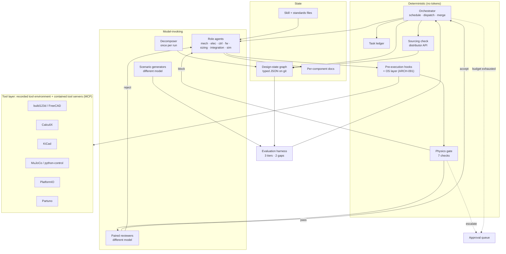

# 02 — Architecture Specification

**Status:** draft 1
**Owner:** Yasin Hessnawi
**Companion:** thesis chapter `Architecture`, which carries the justification. This document carries the implementable detail and is executable without it.
**Convention:** every decision carries an ID `ARCH-nnn`, its dependencies, a cadence, and an acceptance test. Nothing in this document is advice. If an item cannot be executed as written, it is a defect in the item.

---

## S0. Conventions

| Field | Meaning |
|---|---|
| **Decision** | What is built. Imperative, no hedging. |
| **Depends on** | IDs that must exist first. `—` means no dependency. |
| **Cadence** | `once`, `per subtask`, `per module`, `per run`, `weekly`, `on change`. |
| **Acceptance** | The observable that proves it works. |
| **Defer** | Present only where the item is deferred past the first slice. |

**Blocking vs warning.** A *block* halts the pipeline and returns to the producing role. A *warning* is written to the graph and surfaced at the next gate up. No check is advisory.

**Model separation rule.** Three roles must not share a model instance with the implementer: the reviewer, the held-out scenario generator, the validation scenario generator. Enforced at dispatch, not by convention.

---

## S1. Principles

### ARCH-001 — Orchestrator interface and first-slice binding
**Decision.** The orchestrator implements one interface: read the ledger and the graph, emit the next action, emit the merge decision. Two bindings exist. The **deterministic** binding is Python, calls a model exactly once per run at decomposition, and spends zero tokens on scheduling, dispatch, merge or reconciliation. The **model-in-loop** binding makes those same decisions with a model reading the ledger and graph at each step. Gate ordering, hook enforcement and reviewer invocation live outside the interface in both bindings and cannot be skipped by either.

The deterministic binding is the first slice. The model-in-loop binding is a deferred ablation (ARCH-140, ARCH-152).

**Amended 22.10.2026.** One exception to the single decomposition call: the `design_review` value `repair:N` (ARCH-060), an experiment arm and never an ordinary run's setting. Under it, a design review that rejects or blocks the plan leads to a re-plan call, at most N times; each re-plan is reviewed again, every round is recorded, and a plan still rejected or blocked after the N-th is held as under `on` (ARCH-130). A re-plan is told only the original prompt, its previous plan and the review's failing and blocking items between fixed markers, and that text is checked for material no session may read before the call. The run configuration refuses `repair:N` unless the run is reportable. Evaluation runs pin `observe` unless their frozen criteria name `design_review` as an experimental arm; the designer experiments are reportable runs whose criteria do. The design review is a reviewer call, not a decomposition call; under every other value of the flag a run makes exactly one decomposition call.
**Amended 07.11.2026.** A second exception: when the decomposition call's output is refused by its schema, one second call is made inside the same round, as the acceptance states.
**Depends on.** —
**Cadence.** once
**Acceptance.** Deterministic binding: token accounting for a full run shows zero tokens attributable to routing decisions, and, outside `repair:N`, one decomposition call, or two when the first call's output was refused by its schema; the second is made once, inside the same round, and both are recorded with their own tokens. Both bindings: a run cannot reach merge without a gate result and a review result in the ledger, where the review result is a pass or a person's approve bound to the merged commit (ARCH-133).

**Amended 11.11.2026.** An exception to the review result, for measurement only: an ablation run may set `reviewers: off` (ARCH-140). Under it no role reviewer is invoked. Each attempt whose gate result lets it reach review records `review_skipped`, with the reason `reviewers=off`, in place of a review result, as `gate_mode: off` records `gate_skipped`. The attempt then merges on its gate result alone. Gate ordering stays in code: under `gate_mode: on`, an attempt the gate refuses is rejected before the review stage, whatever the reviewers value. The run configuration refuses `reviewers: off` in an ordinary run and in a reportable run. (Owner-approved 11.11.2026.)

### ARCH-002 — State outside context
**Decision.** No fact required after the current subtask lives only in an agent's context. The design-state graph, the task ledger and the specifications are files. Agents re-read rather than remember.
**Depends on.** ARCH-010, ARCH-012
**Cadence.** per subtask
**Acceptance.** Killing an agent session mid-task and restarting it loses no project state.

### ARCH-003 — Enforce, do not request
**Decision.** Any constraint expressible as a deterministic check moves from the prompt into a pre-execution hook.
**Depends on.** ARCH-090
**Cadence.** on change
**Acceptance.** Every constraint in every standards file is either hook-enforced or explicitly listed as judgement-only in S9.

### ARCH-004 — Physics gates, does not advise
**Decision.** The physics layer blocks. It runs before the reviewer, not after.
**Depends on.** ARCH-080
**Cadence.** per subtask, per module, per run
**Acceptance.** A deliberately unit-inconsistent artefact never reaches a reviewer.

---

## S2. Component structure



### ARCH-005 — Session isolation
**Decision.** Every agent session runs in its own git worktree. One agent writes one module. The orchestrator owns commit and merge: a role session runs no git command at all, and git's own files in its worktree are protected from it (ARCH-090). Every git command the harness runs on a repository a session could write is pinned to a verified git directory and ignores any setting, attribute or history-shaping file that repository carries, because a session that can write those files could otherwise steer what the harness commits or reads.
**Depends on.** ARCH-001
**Cadence.** per subtask
**Acceptance.** Two concurrent sessions cannot produce a merge conflict on the same file. A git invocation from a role session is refused, through any wrapper or shell form the hooks can see.

**Registered direction — a product core separable from the thesis machinery.** Not yet a numbered decision. The evaluation harness, the experiments, the held-out tier, the benchmark arms and the research instrumentation exist to measure the system; the orchestrator, graph, hooks, gate, reviewers and their tools are the product. After the thesis the product may continue as an open-source tool with the measurement machinery removed, so the dependency runs one way only: evaluation code may import product code, and product code never imports evaluation or experiment code. New work keeps thesis-only features in their own packages and behind their own flags. A rule that exists only to keep a number honest, such as refusing a reportable run that lacks the OS layer (ARCH-091), lives on the evaluation side, so removing that side changes no product behaviour. An import-boundary test enforces the rule once the split is drawn; until then it binds new work at review.

---

## S3. Design-state graph

### ARCH-010 — Graph schema
**Decision.** JSON, one file per node, committed. Minimum node shape:

```json
{
  "id": "sizing.motor_left",
  "kind": "component | module | requirement | interface",
  "domain": "cross",
  "owner_role": "sizing",
  "quantities": {
    "stall_current": {"value": 2.4, "unit": "A", "source": "datasheet", "written_by": "sizing"}
  },
  "requirements": ["REQ-014"],
  "constrains": ["motor.left", "power.budget", "control.loop_gain"],
  "model": "path/to/executable_model.py",
  "geometry_hash": "sha256:...",
  "updated": "2026-09-18T10:02:11Z"
}
```

A quantity may also name the simulation record it was read off and the extractor used to read it (ARCH-146). The field is optional and left out when absent, so a node that names no record is byte-identical to one written before the field existed.

**Amended 22.10.2026.** The example is now a sizing-owned `cross` node, because a node not of kind `interface` has domain `cross` exactly when sizing owns it (ARCH-051): a quantity constraining more than one domain lives on such a node, joined through `constrains` to the domain nodes it constrains (here the electrical role's `motor.left`). The other domains are `mechanical`, `electrical`, `control` and `firmware`, and an interface node keeps its producing role as owner.

**Depends on.** —
**Cadence.** on change
**Acceptance.** Every numeric quantity in the graph has a unit string. A node with a bare number fails schema validation.

### ARCH-011 — Interface contracts precede implementation
**Decision.** The orchestrator writes every `interface` node at decomposition. A producing agent may read it and may not write it. A hook rejects any commit that modifies an interface node from inside a module worktree.

**Amended 03.11.2026 (owner-approved 13.11.2026).** An interface node that sizing produces takes sizing's values once, by code, in sizing's opening pass, before any module that reads it is dispatched. The decomposition's values on such a node are a forecast of sizing's work, not a contract between domains, and sizing alone owns those quantities (ARCH-051). At the change check of each opening-pass attempt the orchestrator derives the interface's next revision from the attempt's own nodes joined to it (a `constrains` edge either way): each quantity of the interface takes the value, unit and source that the joined nodes hold under the same name. The interface keeps its id, kind, owner, domain, edges, requirements and set of quantity names. The derived revision is part of the attempt: the gate judges it as one of the attempt's nodes, its reviewer is shown it, and the merge writes it and the run branch's contract file. The attempt is refused at the change check, before the gate, when no node of its own is joined to the interface, when a joined node lacks one of the interface's quantities, or when two joined nodes disagree on one. No session writes an interface node: the hook and the store's write still refuse every such write. From the first spawn of a subtask of any module the plan lists as the interface's consumer, the interface is fixed: sizing's closing pass, a reopen and every later attempt leave it as it is, and a later difference is a failed contract clause (ARCH-130). An interface a domain role produces is fixed at decomposition, as before.
**Depends on.** ARCH-010, ARCH-090, ARCH-051
**Cadence.** once per module; for a sizing-produced interface, once more at sizing's opening pass; then immutable
**Acceptance.** An agent instructed to relax its own interface fails at the hook, not at review. A sizing-produced interface whose joined sizing node holds other values carries those values after sizing's opening merge, and the gate's record of that attempt names the interface's quantities. A replayed log whose interface revision is not the derivation, or follows a consumer's first spawn, halts.

### ARCH-012 — Task ledger
**Decision.** Append-only JSONL. One line per subtask with id, spec path, assigned role, attempt count, gate result, review result, merge commit, and the person's decision and its queue item when one acted (ARCH-133).

**Amended 22.10.2026.** When a taken decision reopens a done subtask (ARCH-030), the event log records the reopen as its own line, naming the subtask, the queue item, the digest shown, the merge commit and the attempt it starts; the subtask's ledger line then resets its attempt fields and gains `reopened_by`, the item's id, and the earlier merge stays in the event log.
**Depends on.** —
**Cadence.** per subtask
**Acceptance.** Ledger length equals the number of dispatched subtasks. A skipped task is visible as a missing id, not as an absence.

### ARCH-013 — Divergence detection
**Decision.** Diff the graph after every step. Any node written by a role that does not own it is a blocking failure.
**Depends on.** ARCH-010, ARCH-012
**Cadence.** per subtask
**Acceptance.** Injected cross-role write is caught within one step.

---

## S4. Specifications and reading

### ARCH-020 — Mandatory reading hook
**Decision.** A hook that runs before every tool call lists the required files and refuses every call other than reading them until each has been read in full, at its current content, in that session. The check cannot sit in a session-start hook, because on the agent runtime this architecture uses such a hook announces but cannot refuse. Required set: role standards file, module specification, role skill file, interface contracts touching the module.
**Depends on.** ARCH-090
**Cadence.** per subtask
**Acceptance.** A session that skips a required read cannot make a tool call.

### ARCH-021 — Research phase, switchable
**Decision.** Triggered when a specification names a component or standard absent from the knowledge layer. Findings written to the component document under `## Research`. Flag `--research=on|off|observe`.
**Depends on.** ARCH-020, ARCH-140
**Cadence.** per subtask
**Acceptance.** Running the same brief with the flag off changes only research behaviour, and the delta is attributable.

**Amended 11.11.2026 (owner-approved).** Findings are run-local. A researcher session, the only session with web search and fetch, writes them as a document in the run's records. The harness checks every cited source against what the session was recorded fetching or being shown, scans the document, seals it, makes it required reading for the module's builder (outside the ceiling, as the module specification is, ARCH-023) and puts it in the module reviewer's packet. It never enters the knowledge layer except by a person's promotion (ARCH-100), and a later run reads it only then. The trigger is code. When the flag is not `off`, the plan lists each module's named components and standards, and each listed name that the curated knowledge index does not cover, after a fixed normalisation, is one research item. Research runs after the plan is accepted and before the module's first dispatch, once per module, and repairs and resumes reuse the sealed findings. The researcher runs on its module's builder's model and never on its module reviewer's. Every query and search result is recorded. Every fetched page passes through a harness-owned recording proxy that keeps its full bytes and digest and refuses blocked hosts at every hop. Hosts given as IP literals are refused. A search is told the blocked hosts before it runs and audited after it. The held-out tier's canary scan reads the fetched pages. A failed research step raises an approval-queue item, and the module waits for a person; in a run that only records decisions, the run ends escalated. Under `observe` the items are recorded and nothing runs. **Cadence:** once per module. **Acceptance (unchanged, with one addition):** running the same brief with the flag off changes only research behaviour, and the delta is attributable; with the flag off, the plan request is byte-identical to that of a run before the flag existed.

### ARCH-022 — Specification contents
**Decision.** Every spec file carries: component id, position in decomposition, requirements with success criteria, interface contracts, ordered task list, assigned roles, required reading, deferral markers.
**Depends on.** ARCH-010
**Cadence.** once per module
**Acceptance.** A coding agent handed only the spec and its required reading can begin without asking a question.

**Amended 11.11.2026 (owner-approved).** Five fields (component id, position, assigned roles, required reading, interface contracts) are written onto the specification by code; requirements with success criteria by the decomposition; the ordered task list and deferral markers by the requirements role when the run enables it. Dispatch refuses a specification missing a required field.

### ARCH-023 — Context split
**Decision.** Always loaded and held to the ceiling: the cross-domain standards file, the role's own standards file and the role's skill file. Required reading but not held to the ceiling: the module specification and the interface contracts (ARCH-020). Retrieved on demand: datasheets, standard clauses, prior close-out summaries.

The module specification is outside the ceiling because the ceiling's remedy, trimming a curated file, applies only to content a person curates; a specification's length follows the module's real complexity, and one fixed number cannot bound both without being too loose for the one or too tight for the other.
**Depends on.** ARCH-020
**Cadence.** per subtask
**Acceptance.** The always-loaded set stays under one agreed ceiling, measured in bytes and passed as a recorded run parameter; breaching it is a defect in the standards or skill file, not a reason to raise the ceiling.

---

## S5. Control loop

**Amended 11.11.2026 (owner-approved, with ARCH-021's amendment).** The "required reading but not held to the ceiling" list gains: a run's sealed research findings, for the module's builder.

### ARCH-030 — Loop stages and repair budget
**Decision.** Eight stages, in order: resolve task → spawn worktree session → verify reading → implement under hooks → physics gate → paired review on full trajectory → accept and merge, or reject with repair instruction → diff ledger and graph.
Repair budget is **three attempts**. Attempt 1 rejection returns the finding. Attempt 2 returns finding plus failing check and numeric output. Attempt 3 escalates to the human with all three trajectories attached. A person may order one further fix after a review that blocked (ARCH-133); it is outside the three and is always the last attempt.

**Amended 22.10.2026.** The one fix is also ordered by an arbitration choice (ARCH-130). Choosing sizing's value retries the domain subtask while an attempt is left, its order quoting the graph's `{value, unit}` and provenance; with none left it spends the one fix, if unused, as a `fix_after_arbitration` order carrying the same values in its own fixed template; only when the fix is spent too does the choice end the subtask. The item states which of the three the choice will do before the person decides. A subtask that is done stays done unless exactly one taken decision reopens it: choosing a position on a failed-contract item reopens the other module's subtask to conform to the interface node's values, and replay refuses any reopen that no taken decision explains. A reopen uses the subtask's own budget, never a fresh one: its next attempt, or the one fix when it merged at its third attempt and the fix is unused; with neither left, the choice records only. The earlier merge stays on the record.
**Depends on.** ARCH-005, ARCH-020, ARCH-080, ARCH-060
**Cadence.** per subtask
**Acceptance.** No subtask consumes more than three implementation attempts without appearing in the approval queue. A reopen with no taken decision before it, or one that would start an attempt beyond the three and the one fix, halts replay.

### ARCH-031 — Gate ordering
**Decision.** Physics gate runs before review. Rejected work is never reviewed.
**Depends on.** ARCH-080
**Cadence.** per subtask
**Acceptance.** Review token spend on gate-failed artefacts is zero.

---

## S6. Roles

### ARCH-050 — Domain role definitions

| Role | Owns | Tools | Skill file contains | Reviewed against | Hands off to | First slice |
|---|---|---|---|---|---|---|
| Design | Concept, decomposition, trade-offs | graph, requirement templates | decomposition patterns, abstraction levels, requirement phrasing | requirement coverage, traceability | all | automated |
| Mechanical | Geometry, sizing, mounting, DFM | build123d, a finite-element solver (in the recorded tool environment); an inspection tool server (later) *(amended 12.11.2026, owner-approved)* | material table, fastener rules, wall-thickness and radius minima, DFM checklist | geometric validity, sizing margin, DFM pass | sizing, integration, manufacturing | generated, **human sign-off on sizing** |
| Electrical | Component selection, power budget, wiring, connectors | KiCad command-line checks and exports, a schematic generator (in the recorded tool environment), datasheets *(amended 12.11.2026, owner-approved)* | connector conventions, derating rules, power-budget template | schematic DRC clean, budget closes, parts sourceable | sizing, firmware, integration | automated |
| Control | Plant model, controller, stability | python-control and MuJoCo (in the recorded tool environment); our own control and MuJoCo tool servers. *(amended 15.11.2026, owner-approved)* | plant-model templates, PID and LQR selection rules, margin thresholds | closed-loop stable in sim, margins met | sizing, firmware, simulation | automated, **human sign-off on stability margin** |
| Firmware | Drivers, real-time loop, HAL, on-target test | PlatformIO (in the recorded tool environment), built with its own command in the session's shell; no upload and no device; a firmware tool server of our own (later). *(amended 15.11.2026, owner-approved)* | timing budget rules, HAL conventions, driver patterns | compiles, timing budget met, on-target test passes in simulation *(amended 15.11.2026, owner-approved)* | integration | automated |

**Depends on.** ARCH-010, ARCH-020
**Cadence.** per module
**Acceptance.** Each role's skill file exists and is non-empty before that role is ever dispatched.

**Amended 12.11.2026 (owner-approved).** The mechanical and electrical tool cells name what the recorded tool environment provides. TraceParts and Partuno move to the sourcing check.

**Amended 15.11.2026 (owner-approved).** The control and firmware tool cells name what the recorded tool environment and the tool-server register provide. Simscape and the Arduino command-line tool are not provided. Hardware-in-the-loop is out while hardware reach is refused (ARCH-090).

### ARCH-051 — Cross-cutting roles

| Role | Owns | Type | First slice |
|---|---|---|---|
| Sizing | Every quantity constraining more than one domain | agent | automated, exclusive write |
| Integration | Interface satisfaction, end-to-end behaviour, completion declaration | agent | automated |
| Simulation | The validation environment, built in a run of its own and frozen by digest before any evaluated run uses it, and the scenarios' executability in it; the tiers' content is written by a generator outside every run (ARCH-141) *(amended 11.11.2026, owner-approved)* | agent | automated |
| Requirements | Specification below module level: an ordered task list, per-task criteria traced to the module's criteria, and deferral markers, for each planned module, behind a recorded flag; never a module specification, an interface or a graph node *(amended 11.11.2026, owner-approved)* | agent | automated |
| Manufacturing docs | Drawings, tolerances, PMI | agent | **deferred**, restricted subset only |
| Sourcing | BOM validation against real availability | **deterministic step, not an agent** | automated |
| Knowledge curation | Skill and standards files | **human** | human |
| Red team | Adversarial attack on the design | agent | **deferred** |

**Amended 22.10.2026.** `cross` is marked on the node, interfaces excepted: a node not of kind `interface` has domain `cross` exactly when sizing owns it, and sizing creates no other node; the role register names the owner of each duty through `owns`, sizing `cross_nodes` and integration `completion`, and every check that needs an owner looks it up there, never by a role's name, refusing when two registered roles own the duty or none does.

**Amended 01.11.2026.** Sizing's closing pass, which code places after every domain module, can change a value whose `constrains` edges reach a node of a domain module that no session writes after it, and only that node's owner may rewrite it or say why it need not change (ARCH-082). Before the integration call the orchestrator therefore reopens, by code and once, each domain module the closing pass reached in that way: one session of the module's own role, outside the repair budget (ARCH-030) and never retried, told the changed values, which rewrites the node to agree or keeps its values and says why in `no_change_justified` under the changed node's id. It is gated, reviewed and merged like any attempt. What is owed is computed from the canonical journal and the change history, counting a value as changed when its quantities differ as written, so it may owe a session the propagation check would not ask for and never leaves out one it would; the check stays the authority. No follow-up is owed to a module that merged on any fix, or whose order no reviewer could read whole; there, as for a follow-up not merged, the propagation check decides at the integration call. A follow-up not merged, or a reached module owed none, ends the run escalated at the integration call under the gate mode `on`, naming the edges and how each follow-up ended; under `observe` the check's failure is recorded and the run goes on. There is one round: a follow-up whose own change reaches sizing's nodes again fails the propagation check at system scope, since the design did not converge. Under the gate mode `off`, where that check does not run, nothing is owed.

**Amended 03.11.2026 (owner-approved 13.11.2026).** Sizing's exclusive write covers the interfaces it produces: their values follow sizing's opening pass, by code and never by a session's write (ARCH-011).

**Depends on.** ARCH-050
**Cadence.** per run
**Acceptance.** No node marked `cross` in the graph, interface nodes excepted, is written by a role other than `sizing`.

### ARCH-040 — Arbitration rule
**Decision.** Fixed precedence, no negotiation. Physics gate outranks every domain. Sizing outranks any single domain on a shared quantity. Unresolved after both → approval queue with both positions and the disputed edges.

**Amended 22.10.2026.** "Unresolved after both" means that sizing's precedence did not settle the dispute: the same quantity is disputed again on the same subtask, or the subtask's attempts run out with the dispute open.
**Amended 01.11.2026.** A person's choice comes between the two. Where a person, deciding the approval-queue item of an unresolved dispute, chooses the domain's value and the choice is acted on (ARCH-133), the domain's attempt that returns after sizing's closing pass is ruled at the level `person`: the choice stands when the value the attempt disputes and the value the graph holds both equal the chosen one, the value exactly and the unit as the gate's parser reads it. The physics gate still outranks it. Otherwise the dispute is ruled as before, and one sizing's precedence does not settle again goes to a new item. The level records the decision the queue exists to obtain; it settles nothing a person did not choose.
**Amended 03.11.2026 (owner-approved 13.11.2026).** An interface quantity is never disputed. A sizing-produced interface already holds sizing's value before any domain reads it (ARCH-011), so a domain that disagrees disputes the sizing node joined to it. After that, a difference between an interface and a module's node is a failed contract clause, ruled as one (ARCH-130).

**Depends on.** ARCH-051, ARCH-130
**Cadence.** on conflict
**Acceptance.** No conflict resolution path involves two agents exchanging messages.

---

## S7. Reviewer topology

### ARCH-060 — Paired specialist reviewers
**Decision.** Each producing role has a paired reviewer with its own rubric and knowledge file, running a different model. Reviewer reads the **full trajectory**, not only the artefact.

**Amended 22.10.2026.** Decomposition has a paired reviewer too, the design reviewer, on a model different from the decomposition's. It reads the plan, the brief and the decomposition session's stream, each held to its seal, and runs once per plan under the recorded flag `design_review`: `off` (no review), `observe` (the verdict is recorded and the run proceeds), `on`, or `repair:N` (ARCH-001). Evaluation runs pin `observe` unless their frozen criteria name `design_review` as an experimental arm. Under `on`, a review that rejects or blocks the plan becomes a single approval-queue item that holds every dispatch (ARCH-130); there is never a second decomposition call.
**Amended 01.11.2026.** Two model strings name one model when they are equal once a trailing date suffix (`-YYYYMMDD`) and a provider's spelling of the name (a region prefix such as `us.anthropic.`, a version suffix such as `-v1:0`, a context-window suffix such as `[1m]`) are removed. Every place the separation is enforced compares them so, so a dated or provider-spelled name of the implementer's model is refused as that model.

**Depends on.** ARCH-050
**Cadence.** per subtask; the design reviewer per plan
**Acceptance.** Dispatch refuses to run a reviewer on the same model string as the implementer, and a design review on the decomposition's model string.

**Amended 11.11.2026 (owner-approved).** The simulation role builds what the implementers are judged in, so its model differs from every implementer's and the decomposition's, and its paired reviewer differs from both the simulation role's model and every implementer's. Dispatch refuses either otherwise, by the normalised comparison above.

### ARCH-061 — Implementation order
**Decision.** Control and firmware reviewers first, since those roles are automated first. The electrical and mechanical reviewers follow ahead of their roles, because the injected-error instrument of ARCH-083 sends each domain's artefacts to that domain's reviewer alone, and a domain with no reviewer stops the instrument before any review. Others follow their roles. A reviewer's existence never admits its role: a run refuses to start if it names a role absent from the role register, and a role enters the register only with its standing sign-offs (ARCH-130) wired.

**Amended 22.10.2026.** The design reviewer (ARCH-060) comes ahead of further work on the design role, because decomposition has run unreviewed since the first slice. The product setting of `design_review` is `on`, so the rule holds for the product. `off` and `observe` are stated exceptions, for development and for measurement: under them the plan is dispatched without a review that can hold it, and under `off` without any review, and the run records which value it ran with.
**Depends on.** ARCH-060
**Cadence.** once
**Acceptance.** Every automated role has a paired reviewer before it is dispatched unsupervised. A run naming an unregistered role is refused before decomposition, whether or not a reviewer for that role exists.

**Amended 11.11.2026.** `reviewers: off` (ARCH-140) is a further stated exception, for measurement only. An ablation run under it dispatches every role without its paired review, and it records `review_skipped` for every attempt it does not review. Every role the run names still has a registered reviewer, pinned on a model string other than its implementer's, so the arm's pin set is the full harness's. The reviewers are registered and never invoked. An ordinary or reportable run cannot set it. (Owner-approved 11.11.2026.)

### ARCH-062 — Rubric contents
**Decision.** Each rubric lists: acceptance criteria from the spec, the domain's standard violations, the known antipatterns from the skill file, and an explicit instruction to report reward-hacking indicators (feature isolation, hard-coded values, disabled checks).

Each rubric also:
- **Names what the automated checks cover, and does not tell the reviewer to skip them.** It states that a claim the checks passed is no evidence, and tells the reviewer to judge units, magnitudes, balances and follow-ups by reading. It says nothing about which ran first. In the loop the gate runs first (ARCH-031); in observe runs and in the injected-error instrument the reviewer judges work the gate has not stopped, and a rubric that deferred to the gate would hide exactly the errors ARCH-083 counts.
- **Carries a no-specification clause.** Work submitted without an issued specification is a proposed revision of the design on its own. Section 1 is then one line, whether the revision is consistent with the design it changes and with the rubric, answered met or unmet, never "not evaluable"; the missing specification is not a defect. Without the clause a reviewer can block every such revision for want of a specification, which measures nothing about reviewing.
- **Charges the revision only with what it wrote.** A check that fails only on values the revision did not write is recorded as a non-blocking note; one involving any value it wrote, including a follow-up it failed to make, is judged normally.
- **Treats "not evaluable" as blocking**, with each role's list of what a judgement needs stated explicitly.
**Depends on.** ARCH-060, ARCH-100
**Cadence.** on change
**Acceptance.** Rubrics are versioned; a rubric change is a ledger event. A promoted rubric's change goes through staging and human promotion with a version bump, and an experiment pins the rubric versions it ran. With no issued specification, the answer schema admits exactly one Section 1 line, and a verdict that breaks it is refused.

### ARCH-063 — Maintenance cost, stated
**Decision.** Each pair adds one rubric file and one knowledge file to maintain, and roughly doubles review token spend against a single generalist reviewer. Accepted because reviewer drift toward one issue class is a known failure and because a generalist cannot carry five domains of standards within the context budget.
**Depends on.** ARCH-060
**Cadence.** —
**Acceptance.** Cost recorded per run so the trade is visible rather than assumed.
**Measured so far.** One control attempt, one review per arm: the paired review used 1.63 times the tokens and 1.44 times the list-price cost of a generalist reviewer given the same material, 1.46–1.63 and 1.27–1.44 once a version difference between the arms is removed. Its cost figures predate the per-call pricing of ARCH-145 and have not been re-priced, so the token ratio is the firmer. One measurement on two harness versions does not support "roughly doubles"; the expectation stands unconfirmed until a comparison at one commit with several runs per arm, costed on the runtime's own totals.

---

## S8. Physics layer

### ARCH-080 — Mandatory checklist

| # | Check | Tool | Runs at | Returns | On failure |
|---|---|---|---|---|---|
| 1 | Unit consistency | `pint` | subtask | offending expression, both unit sides | **block** |
| 2 | Magnitude plausibility | the domain's sourced bounds table (`knowledge/<domain>/bounds.toml`) | subtask | value, expected range, source of range | **block** |
| 3 | Static equilibrium and load path | closed form (in the gate) *(amended 12.11.2026, owner-approved)* | module | reaction forces, unbalanced residual | **block** |
| 4 | Power balance | `sympy` + graph arithmetic | module, system | deficit in W, contributing nodes | **block** |
| 5 | Energy and mass conservation | `sympy` | module | imbalance, terms | **block** |
| 6 | Thermal budget | graph arithmetic | module, system | margin in K or W | warn at module, **block** at integration |
| 7 | Cross-domain propagation | graph traversal | system | list of unwritten constrained edges | **block** |

**Depends on.** ARCH-010, ARCH-004
**Cadence.** per subtask (1–2), per module (3–6), per run (4, 6, 7)

**Amended 12.11.2026 (owner-approved).** A finite-element solve is never run by the gate, which starts no process. A role may run one in its session and declare its reactions; check 3 judges the declared reactions as it judges any others, and the split of a mount on more than two supports stays recorded as unchecked. The solve's result is evidence for the reviewer.
**Acceptance.** Each check has a unit test with a deliberately failing input and a deliberately passing input.
**Known hazard.** Checks 1 and 2 hand a role-written unit string to the unit registry, which evaluates any arithmetic in it exactly. A bound on the string's length does not bound that work: a twelve-character exponent tower kept one process busy until a CPU limit killed it, and the gate runs inside the orchestrator's process with no time bound, so one proposal could stall a run without the stall being charged to any attempt. The remedy, a bounded unit spelling checked before the registry sees the string, as simulation records already apply (ARCH-146), is a change to the gate and is not yet made.

**Amended 03.11.2026 (owner-approved 13.11.2026).** What a check judges is set by names, edges and tables, so the gate states its reach and keeps it from depending on a writer's layout:
- **Sizing's opening pass runs at module scope too.** Each subtask of the role that owns the cross nodes is checked at subtask and module scope, because the domains read its nodes as they stand after it. Module scope otherwise still runs when a subtask completes its module.
- **A consumer and its supply on one node.** A node that holds both a stall current and a current limit holds them to the current-limit relation itself, as two joined nodes do. A stall current that no current limit on its own node, or on a node its edges name, bounds is recorded as unchecked, never passed.
- **Bounds that are definitions.** A kind whose span follows from its definition or from conservation, never from a class of product (an efficiency, a duty cycle: 0 to 1), carries an envelope in every domain, with its source. Product-class envelopes stay withheld. A range keeps its name and domain: the inertial sensor's output-data-rate range is held under `output_data_rate` in each domain that writes one.
- **Reach is stated, not inferred from a pass.** Every check's record carries its `evaluated` count. A check that judged nothing passes empty, and the count, never the verdict, is what an evaluation reads as coverage.
**Known limit.** A quantity outside the catalogue's names, or a relation whose nodes are not joined, is still recorded as unchecked: the gate cannot judge what the design does not say in its terms. Checks 3 and 6 judge nothing on a design with no mechanical node and no thermal quantity.

### ARCH-081 — Gate is not editable by agents
**Decision.** The gate directory is protected by a pre-execution hook. No agent session may write to it.
**Depends on.** ARCH-090
**Cadence.** per subtask
**Acceptance.** An agent instructed to modify the gate fails at the hook.

### ARCH-082 — Propagation check definition
**Decision.** For any node whose quantities changed, traverse `constrains`. For each target, if no quantity on that target was rewritten in the same commit and no explicit `no_change_justified` annotation exists, fail.
**Amended 01.11.2026.** The check is unchanged by sizing's closing pass. Where that pass changes a value whose edges reach a domain node, the node's owner is given one session to rewrite it or say why not (ARCH-051), and the check judges what that session wrote.
**Amended 15.11.2026 (owner-approved).** Parts a person declared are given design: the change history's baseline is past them, and attempts are named above it as before. A declared node therefore owes no propagation of its own, as an interface node owes none. An edge from a role's changed node into a declared node is judged as any edge is; its owner answers it with a reason in `no_change_justified`, since no role can rewrite the declared values.

**Depends on.** ARCH-010, ARCH-080
**Cadence.** per run
**Acceptance.** Swapping a motor for one with different stall current, without touching current budget, loop gain or mount inertia, fails the check.

### ARCH-083 — Catch accounting
**Decision.** Every gate event logs: check number, value, node, module, gate mode, the version of the kind catalogue that judged it, and `reviewer_had_passed: true|false|null`. `null` means no review of that artefact exists: in the blocking loop the gate runs first and a blocked artefact is never reviewed (ARCH-031), so there the field is honestly empty. It is informative in observe runs, where the reviewer runs after a gate that does not block, and in the injected-error instrument, where the reviewer sees each artefact alone and first. The headline research quantity is the count of physical errors caught where `reviewer_had_passed` is true.
**Depends on.** ARCH-080, ARCH-060
**Cadence.** per subtask, aggregated weekly
**Acceptance.** The quantity is queryable from the ledger in week one. **If it trends to zero, the contribution is weaker than claimed and the thesis reports that.**

---

## S9. Hook enforcement

### ARCH-090 — Enforced surface

| Constraint | Hook point | Enforceable |
|---|---|---|
| Protected paths, **put back** if changed: the gate, interface nodes, `.env`, frozen experiment results and criteria, the graph store's whole directory, the hooks' own code and settings, the harness checkout, git's own files and each worktree's `.git` pointer, the run's copy of the record writer (ARCH-146) | PreToolUse (file tools and shell parser), then a sentinel after every call | yes, two layers |
| Protected paths, **refuse-only**: session records, the approval-queue decisions file, the state and config directories, the simulation-record outbox (ARCH-146) | PreToolUse | yes for the file tools and for what a command's own text decides; the residual below is closed only by ARCH-091 |
| Reads of the held-out tier, answer keys and review material | PreToolUse | yes for literal paths, including paths inside here-document and here-string bodies; the residual below is closed only by ARCH-091 |
| Unit consistency on committed expressions | PreToolUse | yes |
| Mandatory reading complete | PreToolUse (ARCH-020) | yes |
| Git from a role session: none at all (ARCH-005) | PreToolUse | yes |
| **Tools outside the session's closed tool list**, the admitted tools of the tool servers it is offered among them (ARCH-093) | session settings, and PreToolUse for a server's tools | yes |
| Cross-role graph write | PreToolUse, and the store again when the orchestrator applies proposals | yes |
| Schema validity of graph writes | PreToolUse | yes |
| **A tool server's arguments**: only those its register entry names, and a path only inside the worktree | PreToolUse | yes for what the arguments name; what a server reads in turn is held by its wrapper (ARCH-091) |
| **Uploads, flashing and a board's devices**, for every profile, through a shell command, a file tool's path and a server tool's arguments | PreToolUse, and the OS layer's denial of the devices | yes for what a command's words decide; what only running decides is held by the OS layer |
| **Writes into the run's tool environment** | PreToolUse, the OS layer, and the scan before every session (ARCH-092) | yes |
| Correctness of engineering judgement | — | **no, reviewer + gate** |

**Amended 15.11.2026 (owner-approved).** **The hardware rule.** It refuses the shapes named here, and an error inside the hook is a refusal. A program that only ever reaches a board is refused by name. A program that both builds and reaches a board, named in the command's own words, is read word by word against its named build-only uses: a use, an option or a spelling not named is refused, so an upload by such a program by a route not named is refused without being named.

A word of such a command that only running decides is refused. A program named only when the command runs cannot be known from the words: the hook refuses it only for the shapes named, the build tool's upload, monitor, tests, debugger or devices, and a flasher's options read as words (any `-U`, or `-p` beside `-U`, `-e` or `-c`). With any other words, or none, it passes the hook, and the OS layer's denial of the board's devices is what holds. A program behind a wrapper's option, and the module or script an interpreter runs, are read as in command position; `env -S` is refused.

A board's device is refused wherever a call names it; a pattern that could expand to one is refused as the device. A file tool's path is judged as written and as it resolves, a link to one included. A shell command's words are judged as written. A move is followed when a word names it (`cd`, `env -C`, `sudo -D`, `uv --directory`, `poetry -C`, `parallel --wd`, the options named here and no others); after one that goes where no word says (`find -execdir`, `chroot`, `sudo -R`, a login by `sudo -i`, `su -` or `runuser -l`, a target only running decides) a name that would be a device from anywhere is refused. A directory reached through a link, a name a program assembles, a pattern split across words, and a move by an option not named here (`make -C`) are held by the OS layer's device denial, not by the words.

A relative name is read from wherever the command could be: after a move the rule cannot follow, a name that would be a device from there is refused.

The OS layer denies the same devices, to read and to write, from the same table.

A plain build whose own project file starts a flash passes the hooks by its words; the OS layer's denial of the device stops it.

**Its residual.** The list of programs that only reach a board is not complete; every program in the provisioned tool environment's `venv/bin` is classed by it, or named as reaching no board. A program that talks to a USB device without a device node, which macOS allows, is named by neither layer; the sandbox profile the pinned binaries write opens no USB or HID client, which has been read in the profile and not measured with a device.

**Amended 15.11.2026 (owner-approved).** Every profile's settings deny the binary's own search tool beside the two web tools: role, reviewer, orchestrator and the raw agent. With tool search on, the binary leaves the tools of a session's servers out of the request and tells the model to load them through the search tool first. That tool is on no closed list, so the hook refuses it, and the admitted tools could be reached only through a call that fails. With it denied, the binary offers every tool directly. Nothing is widened: the deny removes a tool, the closed list is unchanged, and every call still reaches the hooks by its own name and input. A run records whether its sessions were denied the search tool, read from the deny lists, never from its parameters (ARCH-145).

**The shell parser's rule.** The parser resolves exactly what a command's own text decides, following braces, quoting forms, literal in-call variables and literal directory changes across the readings of every common shell, and refuses only what it cannot read that way at a stated bound. It never refuses wholesale on doubt, because a layer that refuses ordinary commands is switched off in practice. **Its residual is what only running decides:** values set at run time (substitutions, `read`, special and positional parameters, arrays, `IFS`), the directory after a `cd` through a substitution, scripts fed by a pipe, `xargs` or `source`, interpreters fed a program on standard input, paths a program builds from its input, and any command behaviour the parser's rule lists do not name, since no such list is complete. For put-back paths the sentinel undoes what the parser misses. For refuse-only paths and for reads nothing after the parser catches it, which is why ARCH-091 exists.

**Evidence.** Both experiments drive attempts derived mechanically from a pinned public catalogue of Unix-binary file operations, 755 in all, by a rule fixed before any ran. **R-HK-01:** the 230 whose binary was present were all refused before running, and none reached; the other 525 did not run, so the sentinel was never exercised, and every target lay inside the session's own tree. **R-HK-02:** all 755 were driven. None wrote a byte to a protected path, whether the targets sat in the session's tree or in a separate harness checkout reached by absolute path, but one read reached the held-out tier: a held-out path inside a here-document fed to an interpreter, which the parser did not then inspect. The tolerance was zero reach, so the read boundary was not met. Here-document bodies are now scanned for literal paths; the interpreter-on-stdin class stays in the residual. **The held-out read boundary is claimed only on runs where ARCH-091 is present**, and any new figure for it is a new experiment. The sentinel-alone arm stopped at 214 of 755 on a harness guard and is partial.

**Amended 07.11.2026.** Every session is held to the policy limits the run's decomposition call received, and other limits halt the run as an incident. A change that only adds restrictions set to `allowed: false`, nothing removed or otherwise changed, is resolved by a fixed rule as the session ends: one line naming the rule, both digests and the change, and the run continues. Any other change waits for a person, who resolves it at a terminal: shown the change by key and value, the person confirms, and the line records who, why, both digests and the change; only then does a resume accept the run. The baseline moves by these lines alone.

**Depends on.** ARCH-003
**Cadence.** per tool call
**Acceptance.** Each row has a test. Shell bypass is tested by the pre-registered attempt corpus above and by a parity test that holds every write and read route to the same decision, across real bash, zsh, ksh and dash. A change to the parser is measured for newly refused legitimate commands against recorded ones, and the count is reported. Policy limits (amended 07.11.2026): the live rollout's change is resolved by the rule; every other change halts; a resolution off a terminal writes nothing; a log with its resolution removed or forged does not replay.
**Known residuals.** A process a role session leaves running could write a put-back path after the sentinel's last check; review sessions now stop every process they leave, role sessions do not yet. The sentinel puts back startup files in the harness's software environment but not the installed packages beneath them.

### ARCH-091 — OS layer for shell commands
**Decision.** Where the platform provides it, every shell command of an agent session runs inside the operating system's sandbox, through the agent runtime's own sandbox, switched on per session in the settings the harness generates. No container and no extra install.
- **Writes** are allowed only in the session's worktree, its own temporary directory and its own home.
- **Every protected path** in the session's registry is denied: for writing, for reading, or both, as the registry says. That includes the held-out tier, answer keys, review material, the harness checkout, other sessions' records, the state and config directories, git's common directory, and the session's own credentials and the sentinel's stored copies.
- **The deny list** is generated by one function from the same registry the hooks read, and a test fails on any protected path the function does not map.
- **Strict mode.** A command cannot be retried outside the sandbox, and a repository's own settings cannot widen it.
- **No silent start.** Where the layer is generated, a session whose sandbox then fails to start does not start.
- **Loud degradation, refused unless allowed.** At run start and at every resume the harness probes for the layer. Where the platform cannot provide it, the run records the layer as absent with the reason, in the run's manifest and event log, on standard error and in the operator UI; on Windows this reads "no OS protection". Without the layer a role session's shell is bounded by the text hooks alone, so the run is then refused before any role session starts, at its configuration and at every run and resume, unless its parameters allow the absence: `os_layer_absent`, `refuse` or `allow`, a recorded run parameter of the flag register. An allowed run proceeds, and every run's and resume's record of the layer says the absence was allowed. A run that acts on queue decisions is refused without the layer whatever it allows (ARCH-133). A run recorded before the parameter existed reads as `refuse`. There is no flag that hides the absence.
- **Evaluation runs refuse without it.** A reportable run whose sessions have a shell is refused when the layer is absent, with no override. Review-only sessions, which have no shell, are outside this rule. The rule lives with the evaluation machinery, not the core, so that removing the measurement machinery changes no product behaviour: the product may run without the layer, with the warning and the allowance, and a measurement may not. The evaluation also refuses a reportable run that names the allowance, whatever the layer where it runs.
- **The runtime is pinned** to a version carrying the sandbox fixes the layer depends on; older pinned versions stay for reproducing old runs and record the layer as absent.

The parser of ARCH-090 resolves what a command's text decides; it cannot see what only running decides, and for reads and refuse-only paths nothing after it would. An operating-system rule is enforced on the running process whatever the command's text, so it closes the class the parser's rule lists can only name.

**Depends on.** ARCH-090, ARCH-003
**Cadence.** per session; probed at run start and at every resume
**Acceptance.**
- With the layer on, commands the parser cannot judge reach no protected path: an interpreter fed a program, a path built at run time, a symbolic link, a pipe-fed shell, a hard link.
- With the layer off, the same commands are recorded as reaching, which shows the probe can see a reach.
- Ordinary builds, tests and read-only operations in the worktree still succeed.
- A run without the layer records "absent" with its reason and is refused before any session starts unless its parameters allow the absence; an allowed run runs, and its record of the layer says so. A reportable run with shell sessions and no layer, or one that names the allowance, is refused before any session starts.

**Known limits.**
- The file tools and the hooks run outside the sandbox; ARCH-090's hooks remain their layer.
- An admitted tool server, which the binary starts outside the sandbox, runs inside a wrapper the harness generates from the session's own policy. Both wrappers are allowlists: on macOS a generated sandbox profile that denies by default, on Linux a bubblewrap root that holds only the listed places.
- Inside it a server reads nothing the session's commands may not read and none of the simulation-record outbox, writes only a directory of its own in the session's temporary directory, made empty at its start, reaches no network, opens no board device and is given none of the session's credentials.
- A server not named by its wrapper is refused at the spawn, and where the platform has no wrapper no server is offered.
- A path a session swaps for a link after it was judged is not followed out of the wrapper.
- On Linux a server may run the system's own programs, which run inside the same wrapper: no network, no home, no denied place. On macOS any place's name, size and times, and the root's own listing, stay readable to a server, never a denied file's content.
- A denylist hides only what it names: another checkout of this public repository on the same machine is not in any run's registry, so held-out material is kept only where it is registered and never in git.
- A per-path rule cannot tell one program from another, so a path a script may write, such as the simulation-record outbox, is protected by its collector rather than by this layer (ARCH-146).
- Hard links that already exist are not undone.
- The network is unchanged: in the permission mode role sessions run in, the sandbox's proxy lets every host through. The setting is recorded with the run.
- The layer is absent wherever the platform cannot run it: native Windows; a Linux host that lacks the sandbox's packages or forbids the user namespaces it needs, including the project's current evaluation server. Runs with shell sessions that must be reportable therefore run where the layer is present.

**Amended 15.11.2026 (owner-approved).** The first known limit, "The file tools, the hooks and tool servers run outside the sandbox; ARCH-090's hooks remain their layer.", is replaced by the first six limits above.

### ARCH-092 — Tool environment
**Decision.** A run may name a tool environment: the interpreter, the libraries and the native programs its role sessions compute and build with, under roots of their own.
- **Recorded as measured.** The run records what was measured, never what its parameters claim: the interpreter as named and as resolved, its version, every library and native program with its version, the roots, and the digest of a manifest of every entry under the roots (each file by mode, size and content digest), with the entry count and total size.

A run that names none records exactly what it recorded before the field existed.

- **Refused where its bytes could change unseen.** An environment is refused if a file has a second name, a link leads out of the roots or loops, an entry is not a file, directory or link, a program or the prefix lies outside the roots, the roots nest, or its interpreter can import the harness.

It is refused where it overlaps the harness checkout, the run's directory or any temporary directory, and a run that names it beside another interpreter for its role sessions is refused.

- **Held to its bytes.** The environment is measured in full the first time a process dispatches, on a new run and at every resume, and must equal the record. Before each later session every entry is scanned for device, inode, size, mode and modification and change times against that measure. Any difference refuses the session before anything of it exists. Both roots are measured before every session: 2.45 s on the university host (median of 7) and 1.2 to 1.6 s on CI, for 99,116 entries. A change made while a session ran is named when it ends.
- **Read and run, written by none.** Each session is installed with the environment's roots. Its file tools may read them and never write them, a shell command that names one and is not a plain read is refused, and the OS layer denies every write into them.

The session finds the environment's programs first on its search path, and its scripts are told the environment's roots and digest.

- **Offline.** All network use happens at provisioning, outside every session. A role session computes and builds firmware with the environment with no network and git refused, each build in a core directory of its own in the session's temporary directory.
- **Provisioned apart from the harness.** The environment is built from its own locks, taken a week back, by copying files and never linking them, and is left read-only. The harness's own lock and interpreter hold none of its libraries.
- **Build output stays out of the commit.** An attempt whose commit adds, inside its module, a file beneath a named build directory (`.pio`, `.pioenvs`, `build`, at any depth) or a file with a named built-file suffix (`.elf`, `.axf`, `.hex`, `.bin`, `.uf2`, `.eep`, `.o`, `.a`, `.map`, `.lst`), each matched in any case, is out of scope: refused before the gate with the paths named, at no gate run and no review. A module's own data under one of these names is refused with them; it goes under another name. A build's output under a name not listed is not refused.

**Known limits.** The scan before each session reads metadata, not content: a rewrite of the same size within one tick of the file clock after the file's last write is not seen. No session can make one, since the environment is denied to its writes and written only at provisioning.

### ARCH-093 — Tool servers
**Decision.** A role session and the raw agent may be offered tool servers, and only those a register names. The register names, for each server, its tools, every argument each may be given and how the server starts. It names our own control and MuJoCo servers.
- **The closed list.** A session's closed list names exactly the admitted tools of the servers it is offered. A reviewer and the orchestrator are offered none.
- **Tools that reach a board.** The register lists, apart from any server, the tools a firmware server offers that reach a board, a port or a probe. A register whose server admits one is refused when it is loaded, and a call to one is refused under any server's name, even where a session's list names it.
- **The argument rule.** An admitted tool is asked only what its register entry names: an argument the entry does not name, or of another kind, refuses the call. An argument the entry marks as a path is judged as a file tool's read or write of that path would be, and must lie inside the session's worktree however it is spelt: relative, through `..`, through a link, or as a case variant. Only the MuJoCo server reads a relative path, from the worktree.

A tool the register does not hold is refused by name.

- **Only the harness's servers start.** Every session is spawned in the binary's strict tool-server mode with its configuration given inline: the empty one for a reviewer, on its resume too, and for the decomposition call, and for a role session only the servers it is offered. A server named in a file around the session does not start.

The most one server answer may hold is set by the harness (25,000 tokens), never left to a remote flag.

- **Started from the record.** Each server starts by absolute path from the root of the recorded environment that holds its program. A run continued on another register or another output bound starts no server.
- **Only inside the OS layer.** A server is offered only where the OS layer contains it (ARCH-091); a run without the layer, or without servers, offers none. A run that names servers without a tool environment is refused.
- **Working aids, not evidence.** No server's answer backs a sealed record: records come only from module scripts (ARCH-146).

**Known limits.** The hooks see a call's arguments, never what the server does with them; what a server reads in turn is held by its wrapper (ARCH-091). Code a session hands a server runs no wider than the session's own shell. A heavy valid argument can use processor time or memory until the session ends.

No community PlatformIO server is shipped. That server writes its own state into the project directory it builds, and its wrapper lets it only read the worktree, so a build through it fails before it starts. Letting it write there would let a project file's own scripts write the module outside the hooks. Firmware is built with the environment's own build command in the session's shell, inside the OS layer. A firmware server of our own is later work.

---

## S10. Knowledge and skills

**Amended 11.11.2026 (owner-approved, with ARCH-021's amendment).** Known limit: the binary's web fetch runs outside the sandbox; the researcher's fetch is held by the recording proxy, and every other session's by the deny rules and the tool list.

### ARCH-100 — Human-gated skill promotion
**Decision.** Successful episodes emit candidate skills, failures emit candidate antipatterns, both to `staging/`. Nothing enters the retrievable library without human promotion.
**Depends on.** ARCH-050
**Cadence.** per subtask (emit), weekly (promote)
**Acceptance.** Library contents are a strict subset of promoted items.
**Defer.** Automatic promotion is a later phase, contingent on staging data showing promoted skills raise measured pass rate.

### ARCH-101 — Standards files
**Decision.** One per domain, read before any work in that domain. Contains the rules that apply to every task, not to one. Human-gated rather than human-written: each rule is drafted from cited literature by agents kept blind to the evaluation corpus, reviewed adversarially, and enters only on a person's promotion (ARCH-100). Skill files and reviewer rubrics follow the same path.
**Depends on.** ARCH-020
**Cadence.** on change
**Acceptance.** Every automated role has a standards file before first dispatch.

---

## S11. Manufacturing output

### ARCH-110 — Restricted generation scope
**Decision.** Generate: standard views, dimension scheme, a rule-checkable GD&T subset (datum from largest planar face, position tolerance on holes), ISO 286 fit selection from functional tags on the graph, STEP AP242 with semantic PMI. Check each with a deterministic syntax and completeness validator. **Human sign-off required on every drawing.**
**Depends on.** ARCH-010, ARCH-051
**Cadence.** per component
**Acceptance.** A generated drawing passes the validator and a machinist can produce the part from it.
**Defer.** General tolerancing from functional intent. No measured automation exists for it.

### ARCH-111 — Staleness by hash
**Decision.** Record `geometry_hash` when a drawing is produced. Compare on every graph change. Mismatch marks the drawing stale and regenerates. Never patch.
**Depends on.** ARCH-010, ARCH-110
**Cadence.** on change
**Acceptance.** Changing a dimension invalidates the drawing within one step.

### ARCH-112 — Assembly manual
**Decision.** Assembled from per-component close-out documents, BOM and wiring definition. Validation is the physical build by mechatronics students working from the manual alone.
**Depends on.** ARCH-110, ARCH-120
**Cadence.** per run
**Acceptance.** Students complete the build without consulting the design team. Failures are logged as manual defects, not build defects.

---

## S12. Buildability

### ARCH-120 — BOM validation
**Decision.** Every line validated for availability, unit price, MOQ, order multiple and **lead time to Norway**. Any failure returns the line to the electrical role as blocking. Norway sits outside the EU customs union, so VAT and customs handling apply to non-EEA imports and are recorded per line.
**Depends on.** ARCH-051
**Cadence.** per run
**Acceptance.** Every BOM line is purchasable and deliverable inside the project timeline, or the design changes.

### ARCH-121 — No autonomous purchasing
**Decision.** The sourcing tool may query and may not order.
**Depends on.** ARCH-120
**Cadence.** —
**Acceptance.** No order-placing capability is exposed to any agent.

### ARCH-122 — Parts the user has or can make
**Amended 15.11.2026 (owner-approved).** This entry replaces the registered direction of the same name.

**Decision.** When the run is configured for it (`parts_on_hand: on`), the decomposition's one answer also lists the design's components, at most twenty. Each has a node id, a domain, the role of the module it belongs to, a label, and the quantity names a part on hand must state: its own, written on the component's node, and shared ones, written on sizing's node for that component. Before any subtask is dispatched, the orchestrator lists one approval-queue item per component (ARCH-130) and holds the run, with no timeout, until each is decided by a choice:

- **have it:** the person states the part's real specifications as a typed body, each a value with a unit. A quantity the gate's catalogue names must be stated in a unit of its kind's dimension; a name the catalogue does not know is admitted, and the gate records it as unchecked;
- **make it:** a custom part, with the values and short texts the person states;
- **find it**, the default: nothing is stated, and the part is sourced and sized as before.

The choice is recorded by the queue's one decision function, under its lock and against the view the person was shown. Approve and reject are refused on a parts item, and a refused decision writes nothing. The command line and the operator UI's one decision route carry the same body; "find every remaining part" is one command, and code never chooses.

When the last item is taken, the orchestrator alone writes each stated value onto its node as a *declared* quantity, which names the item, the digest of what the decision stated, and the person. The physics gate then judges each declared value's unit and range (the subtask-scope checks of ARCH-080) before any session runs: a blocking result raises each part it names again as a new item quoting the finding, with no session spawned and no review spent, and the run is released on a clean or observed result. A domain interface that contradicts a declared value raises its part again before the gate. The release writes a parts record (each component's choice, values and texts) that every role session and every reviewer is given as required reading, held to the digest the release records.

A declared quantity is fixed. No role creates, changes, re-units or removes one, sizing included, or changes the kind or domain of the node it sits on; a role may add quantities of its own beside it, and the node's owner may add an edge to it but never take one away or replace it, since only the owner joins a part's node to its module and an edge taken away would take the declared value out of that module's mass, power and loads. The proposal hook and the orchestrator's apply step refuse the attempt as a refusal the session can repair, the store refuses it again, and a write that passes all three is an incident that halts the run (ARCH-090). A dispute on a declared quantity is refused. Replay rebuilds every declared write from the recorded decisions and refuses one that no decision explains or whose digest differs, and the declared quantities at the journal's head must be the ones the parts writes landed.

The physics gate checks declared quantities exactly as it checks every other quantity: a declared part is an input to the design, not an exemption from it, and no check reads provenance. The checks that read values together (equilibrium, power, conservation, thermal) see declared values at module scope, and every check sees them at system scope. A blocking finding at an attempt's end made only of range findings on declared values goes to the person, since no role can repair it; any other finding (a balance, a load or a unit finding, or one that names a role's value or no value) goes back to the role, with the declared values marked fixed. To the system-scope call the declared parts are given design, as decomposition's interface nodes are: written before any attempt, they stand below the change history's baseline (ARCH-082), and every check still reads them.

Sourcing (ARCH-120) is to read each component's choice from the release through one read function and record parts marked have or make as skipped, owned or custom, never as validated. Until the sourcing step's bill-of-materials task lands, the consumer is a stand-in that records exactly that, and no product code calls it yet. A different choice after the run is released means a new run. The switch is a recorded run parameter with no default; it needs a run that acts on decisions, and so the OS layer (ARCH-091, ARCH-133): where the layer is unavailable, today on Windows, the product runs with it off. Evaluation runs set it off, and a run with it off is byte-identical to a run made before it existed.

**Depends on.** ARCH-001, ARCH-010, ARCH-030, ARCH-040, ARCH-051, ARCH-080, ARCH-082, ARCH-090, ARCH-091, ARCH-120, ARCH-130, ARCH-133
**Cadence.** per run (the decisions, the release and its gate run); per subtask (the guard and the routing); per journal account (the head check)
**Acceptance.**
- A role's proposal that creates, changes or removes a declared quantity is refused at each of the three layers.
- A part declared with an implausible value is blocked by the gate and reaches the person with no repair attempt and no review.
- No subtask is dispatched while a parts item is open.
- With the feature off, a run's prompt, schema, events, ledger and store are byte-identical to a run without it.
- Sourcing validates no line whose component is marked have or make (shown today on the read function and its stand-in consumer; owed again by the real sourcing step).
- A parts decision is recorded only through the queue's one decision function, from the command line or the UI's one decision route; a value without a unit, in the wrong dimension, or a body that does not go with its choice is refused and writes nothing.
- Replay refuses a declared quantity that no recorded decision explains.
- A scripted run on the reference brief with one part owned, one made and the rest found runs to its end, and re-run from its recorded configuration under the same run id, with the recorded decisions fed back and the clock and commit dates pinned by the test rig, reproduces every record of it.

**Amendments that go with it:**
- **ARCH-130:** the sources gain "a parts decision (ARCH-122)", whose positions are have, make and find. A choice may carry a typed body, written by the same one function.
- **ARCH-010:** a quantity may carry a declared record (item, decision digest, person). It is optional and left out when absent, so older nodes stay byte-identical; it goes only with its reserved source, and any source that imitates that one is refused.
- **ARCH-040:** the precedence becomes physics gate, then a person's declaration, then sizing, then a single domain. A declared quantity cannot be disputed.
- **ARCH-051:** sizing's exclusive write on `cross` quantities excludes declared ones.
- **ARCH-082:** parts a person declared are given design: the change history's baseline is past them, and attempts are named above it as before. A declared node therefore owes no propagation of its own, as an interface node owes none. An edge from a role's changed node into a declared node is judged as any edge is; its owner answers it with a reason in `no_change_justified`, since no role can rewrite the declared values.
- **ARCH-120:** lines for have and make parts are recorded as skipped, with the reason.

---

## S13. Human oversight

### ARCH-130 — Approval queue item
**Decision.** One queue. Its sources: gate escalation, exhausted repair budget, unresolved arbitration, a review that blocks on a defective specification, a review that ends without a verdict (never counted as a pass or a fail), and an escalation decision (ARCH-131). Plus standing sign-off on mechanical sizing, control stability margin and every drawing.
Each item carries: decision required, artefact diff, triggering finding, the three most relevant quantities, link to full trajectory. Each item also names the attempt and commit it concerns, and what approve and reject will do to it and why (ARCH-133).

**Amended 22.10.2026.** Two sources are specified in full, and one is added.
- **Unresolved arbitration** (ARCH-040) is raised by code, never by a session. A domain role's recorded dispute of a sizing value is settled first by the gate and then by sizing's precedence, which rejects the attempt before review; it reaches the queue when the same quantity is disputed again on that subtask, or when the dispute falls on the subtask's last attempt. A failed interface-contract clause that no gate result names reaches it too, as an item on the pair of modules.
- **Plan review**, new: under `design_review: on`, a design review that rejects or blocks the plan (ARCH-060), or under `repair:N` one that still does after N re-plans, raises one `plan_review` item that names no subtask and holds every dispatch. It carries the verdict, each failing or blocking item, the plan's digest and, under `repair:N`, every round's verdict. Approve releases the hold. Reject ends the run with the plan rejected and nothing dispatched; a rejected plan is never re-planned, and a new run is a new decomposition. In a run that only records decisions, the item stays open and the run ends escalated.

Arbitration and contract items take a third verb, `choose`, with a position; it is refused on every other item, at the writer and at replay. There is one `position` field, and its allowed values come from the item's kind, which the item states: an arbitration item takes `sizing` or `domain`, a contract item `producer` or `consumer`. On a dispute the positions are sizing's and the domain's: choosing sizing's value retries the domain subtask or spends its one fix (ARCH-030, ARCH-133); choosing the domain's value gives it to the closing sizing pass, which code places after the domain modules, as fixed input, and the disputed attempt then returns to the gate with no new session and no attempt spent. On a contract item the positions are producer and consumer: the chosen module stands and the other reopens to conform to the interface node (ARCH-030), and a position whose own module breaks a clause of the pair records only. No choice merges an attempt; every later merge passes gate and review. The item states what each position will do, and why, before it is decided, and approve and reject on these items still record only.
**Depends on.** ARCH-030, ARCH-040
**Cadence.** as raised
**Acceptance.** Median review time under one minute. **Items that cannot be compressed to that indicate the decomposition is too coarse and are logged as such.**

### ARCH-131 — Escalation decision interface
**Decision.** The question "does this subtask go to the approval queue" is asked through one interface, `decide(question, state) -> (answer, confidence, backend_id, latency_ms)`. Question kinds are `yes_no`, `choice` and `score`; only `yes_no` is exercised in the first slice. `state` is the structured subtask record at the end of an attempt — the ledger line, the gate result, the reviewer verdict, the changed-node summary. No free text in the first slice.

A confidence **below 0.8 routes to ARCH-130 whatever the answer**. The threshold is a property of the interface, not of a backend, so every backend is judged on the same routing rule.

The default binding is `rules`: exactly the deterministic conditions ARCH-030 and ARCH-040 already specify, emitted at confidence 1.0. Every other binding is an ablation arm and enters only through ARCH-132.

**Relationship to ARCH-001.** A binding is admissible only if it spends **zero tokens on the decision** and its weights or rules are frozen at a recorded version. This is a deliberate and bounded carve-out from the invariant: ARCH-001 forbids a model deciding *what runs next and whether to merge*, because such a model can be argued out of routing and there is no downstream check on it. Escalation is a different decision with an asymmetric failure mode — over-escalating costs a minute of human attention, under-escalating is still caught by the physics gate and the reviewer, both of which run regardless. The carve-out does not extend to scheduling, dispatch, merge or reconciliation, and no backend may read or write the design-state graph.

**The state's schema.** It was deliberately left undefined until its sources existed, so that the architecture would not inherit a study's field names from the only structured state then available, a synthetic one. Its trigger has fired: `state` is now a frozen record with no free text, in which every field is copied from one recorded line: the task ledger line (ARCH-012), the line that ended the attempt, the structured parts of the gate result (ARCH-080) and of the reviewer verdict or its absence (ARCH-060), and the change check, which names the nodes the attempt proposed. Replay refuses a recorded state that differs from the one rebuilt from the lines before it. The question is asked at every attempt end that did not merge, and not after a merge. **Every row in ARCH-132 whose evidence was gathered on a generated state says so**, because a backend measured on a shape other than this one has been measured on a proxy.

**Depends on.** ARCH-012, ARCH-030, ARCH-040, ARCH-060, ARCH-080, ARCH-130
**Cadence.** per subtask, at the end of an attempt that did not merge
**Acceptance.** With the `rules` binding the approval queue receives exactly the items it receives with no interface at all, proven by a test that runs both. Every call records answer, confidence, backend id and latency as one line in the run's event log, so a backend's behaviour is auditable after the fact rather than at the time. The task ledger (ARCH-012) is the event log's fixed-shape projection and is byte-identical with and without the interface. A route forced by the repair budget, or by a blocked or verdict-less review, cannot be removed by any backend; a backend can only add escalations.

### ARCH-132 — Escalation backend register
**Decision.** Bindings enter by name, with a status and an entry condition. A backend enters only on a pre-registered experiment's pass, and its row cites that run.

| Backend | Status | Entry condition and evidence |
|---|---|---|
| `rules` | **ships**, the default | none; it is ARCH-030 and ARCH-040 expressed through the interface |
| `llm` | **listed, off and refused** | spends a model call on each decision, which ARCH-131's admission rule (zero tokens on the decision) forbids. It is listed so the refusal is on record rather than silent; enabling it would first need that rule changed, as its own decision |
| `tsetlin` | **contingent, parked** | R-TM-01, four runs. Calibrated humility off-distribution held in every run and no baseline reproduced it; accuracy parity did not, and clause legibility failed twice. Carries a provenance caveat: the selected region was first seen in an earlier run's post-hoc frontier. Rerun as a baseline arm in R-LAYA-01, where it was the only arm to satisfy calibration, humility and selective accuracy together, **and only uncalibrated**: with its temperature fitted on in-distribution data, its humility on the unseen-domain set falls below the bar and its accuracy on the decisions it keeps off distribution falls from about 0.99 to 0.74–0.81. That run reused this generator and configuration, so it is a transferability check of a known answer rather than independent evidence, and its latency on the orchestrator's machine is unmeasured |
| `laya` | **parked** | R-LAYA-01. Fine-tuned, it answers every state at confidence 1.0 and does not become less confident off distribution under any temperature configuration: the humility criterion fails on both off-distribution sets, which is a pre-registered kill criterion, and accuracy on the decisions it keeps falls to 0.45 on one of them. In-distribution calibration passed, and is uninformative for a model that reports no uncertainty. Measured on a generated state, not the system's own (ARCH-131) |

**Depends on.** ARCH-131, ARCH-140
**Cadence.** on change
**Acceptance.** Only `rules` is enabled by default. Every other binding is an independent flag under ARCH-140 and every flag combination runs to completion. A row whose experiment has not passed reads *contingent*, and the system refuses to enable it outside an ablation run. **No entry condition admits a backend on in-distribution calibration alone.** A model that reports no uncertainty passes a calibration criterion whenever it is accurate on familiar data, which R-LAYA-01 demonstrated, so calibration is always paired with humility measured off distribution. **A calibration step is judged by its effect off distribution too**: in the same run, fitting a temperature on in-distribution data improved one arm's calibration and made it measurably less safe where the data were unfamiliar.

**Registered direction — an AI collaborator as a third party.** Not yet a numbered decision; more context is to come before it is specified. A chat model that works beside the orchestrator, not as it:
- **It acts only through an enumerated set of tool calls**, the same actions a person has. It starts a run after interviewing the person for the brief, applies requested changes (to the ledger, a node, a specification, a running model) at the orchestrator's safe points, and later operates tools and simulations.
- **Every action is recorded as the collaborator's**, quoting the request that caused it, so a fault can be attributed to the orchestrator, an agent, the collaborator or a person.
- **It never has more than a person has:** it cannot skip the gate or a review, and cannot touch frozen material.
- **It is independent of the orchestrator binding.** Deterministic against model-in-loop (ARCH-140) is decided by evaluation and does not change the collaborator, nor the reverse. It decides nothing the orchestrator decides, so it is not an exception to ARCH-001.

The channel by which a role agent's question reaches a person moves under it. It becomes a numbered entry when its specification is registered.

### ARCH-133 — What a queue decision does
**Decision.** A person decides an approval-queue item (ARCH-130) with a verb, approve, reject or, on arbitration and contract items only, choose (ARCH-130), and a note; a rejection needs its note. The orchestrator takes each decision into the run's event log at the first point where no attempt is in progress, and acts on it there, in code. Nothing a person decides is carried out by a model, and nothing is carried out while a session runs.

*Approve* merges the attempt the item names, exactly that commit, through the same merge the loop uses for a reviewed attempt: its proposals applied under the design-state store's own refusals, the run branch checked, the commit merged, the graph diffed. An approve may merge only an attempt that every automated check let through: its reading verified, its change check clean, its gate result one the run's gate mode merges, and every trajectory of the subtask still as sealed. It may merge none when a review of any attempt of the subtask confirmed a reward-hacking indicator, or when the scan that runs before review found one in the streams of any attempt no review judged, since an earlier attempt's work is in the commit an approve merges. What a person overrides is the review alone: a verdict that failed, never came, or blocked on the specification. A physics-gate failure is never overridden by an approve, at subtask or at system scope, because a gate a person can wave through no longer blocks (ARCH-004, ARCH-040). On any other item an approve is recorded and merges nothing, and the item states what each verb will do, and why, before it is decided.

An approve binds to what was shown. The item names the attempt's commit and carries its diff; the decision carries the digest of the item's line as shown, and each linked trajectory's seal status is checked again under the queue's lock. A queue line is read only in the one form its writer writes, and a decision's free text is exactly its verb and note, so a line cannot mean one thing to the person and another to the run. When the orchestrator takes the decision it rebuilds the item from the event log with the builder that listed it and refuses any difference, so a person cannot be shown one attempt, stream or finding and have another merged; a mismatch halts the run. A decision without that binding is recorded and acts on nothing.

*Reject* spends the attempt. With the repair budget not exhausted (ARCH-030), the next attempt starts from the repair template with the person's note quoted as the finding. With no attempt left, the subtask ends rejected. A rejection of an attempt whose review blocked on the specification gets one fix instead: a fresh session of the same role and model, in the subtask's worktree, told the review's verdict and the person's note in a fixed template, and nothing of the earlier session. It runs under the same enforcement as any role session, and is gated and reviewed like any attempt, its reviewer told that it is the fix a person ordered and what it was told. If it is not merged, the subtask ends rejected, with no escalation question; there is no second fix. The note and the quoted verdict are bounded, recorded verbatim, given to the next reviewer, and refused, halting the run, if they show material no session may read. The note's bounds are held wherever a decision line is read, not only where it is written: its length in characters and lines, and no control or format character, so the text a person sees is the text a session reads. A rejection whose ordered session's reviewer could not read what that session is told whole ends the subtask instead, before any session, and the decision taken says so. Neither changes a specification, interface node, required reading or hook.

**Amended 22.10.2026.** The verb `choose` in the first paragraph is this amendment's. The one fix can also be spent by an arbitration choice: choosing sizing's value when the subtask has no attempt left orders it as `fix_after_arbitration`, a fresh session told the graph's `{value, unit}` and provenance, and the person's note if there is one, in its own fixed template, then gated, reviewed and ended exactly as the fix after a blocked review (ARCH-030, ARCH-130). The fix runs in the subtask's worktree, except when it is spent on a reopen (ARCH-030): it then starts in a fresh worktree from the run branch's head, which already holds the subtask's earlier merge.

When every planned subtask is merged or ended, the integration call runs again on the run branch as it now stands, so an approved merge is judged at system scope like any other. A run that has ended is resumed to take its decisions, and only after every session it left behind has been stopped and its record read. A run that acts on decisions runs only inside the OS layer (ARCH-091), the one layer that keeps a session's own shell from the decisions file: it is refused at its configuration, and at every run and resume, where the layer is absent or unrecorded. Behind that, the decisions file is held append-only: each session's start records the digest of the file as it then was, and a decision is taken only while every such prefix is unchanged; otherwise the run halts. A decision written while a session ran without the layer, if one ever did, acts only once the operator confirms it on the command line. Whether a run acts on decisions is a recorded run parameter, `act` or `record`; a run recorded before the parameter existed reads as `record`, and the evaluation harness runs with `record` and refuses a reportable run that acts, so no measured outcome is changed by a decision taken during it.

**Amended 01.11.2026.** A reopen ordered by a choice on a failed-contract item (ARCH-030) is told, in a fixed template of its own (`contract_conform`), the interface node's values its module is to conform to, and the person's note if there is one. The order's kind follows the cause, and the budget slot is the subtask's own either way: its next attempt, or its one fix when that is the slot left. A choice that would reopen a module once the integration call is on the record is refused, so no completion rests on a module reopened after it was judged at system scope; the decision records only, and says so.

**Depends on.** ARCH-001, ARCH-030, ARCH-040, ARCH-060, ARCH-080, ARCH-091, ARCH-130
**Cadence.** as decided, at a subtask boundary
**Acceptance.** An approved attempt is merged by the same merge function, with the commit the item names, and the integration call then runs; a test does this on a run that had already ended, with the real loop, git, store and gate. An approve on an attempt the gate failed, the change check refused, or on a subtask any of whose reviews confirmed a reward-hacking indicator merges nothing, each proven by its own test and a mutation of its guard. An item rewritten before it was decided halts the run at take. A rejection with attempts left dispatches exactly one further attempt whose repair instruction quotes the note; with none left, none. A rejection after a blocked review dispatches exactly one fix session, installed as a role session is, whose acceptance merges and whose rejection ends the subtask. No decision is taken between a session's spawn and its attempt's end, nor before a resume has read every leftover session's record, nor from a decisions file rewritten beneath a session's start; a run that acts is refused without the OS layer. Every decision taken is one line in the event log naming the item, the digest shown, the verb and what it did.

---

## S14. Evaluation

### ARCH-140 — Ablation switches
**Decision.** Independent flags, each disableable without the others: research phase, physics gate (`on|off|observe`), paired reviewers, skill library, hook enforcement, prompt optimiser, orchestrator (`deterministic|model-in-loop`), design review (`off|observe|on|repair:N`).

**Amended 22.10.2026.** `design_review` (ARCH-060) joins the list. It is required and recorded for every new run, and `repair:N` is admitted only in a reportable run whose frozen criteria name it as an arm (ARCH-001).

**Orchestrator variants.** The deterministic variant is the first slice and is built first, since the evidence favours it and it is testable against injected errors before any agent exists. The model-in-loop variant is a deferred ablation: same graph, same ledger, same hooks, same gate ordering, but scheduling, dispatch and merge decisions are made by a model reading the ledger and graph at each step rather than by code. It must not be able to skip the physics gate or the reviewer, so gate ordering stays in code in both variants. What varies is only who decides what runs next and whether to merge.

**Depends on.** all of S1–S10
**Cadence.** per run
**Acceptance.** Every flag combination runs to completion.
**Priority.** The physics gate in `observe` mode is the most important single ablation, since ARCH-083 is only interpretable against a run where the gate watches without blocking. The orchestrator ablation is the second most important, because no study has measured deterministic against model-driven coordination on a design task whose artefact is physical. It is run only if time allows after the first slice is complete and measured.

**Amended 11.11.2026.** The switch "paired reviewers" becomes "role reviewers (`paired|generalist|off`)": `generalist` reviews each role's work with its paired rubric less the two domain sections and without the role's library files, on the same reviewer pin (the instrument of ARCH-063's measurement, moved into the loop). `off` is admitted only in an ablation run (ARCH-001). (Owner-approved 11.11.2026.)

**Amended 11.11.2026 (acceptance).** Every flag combination either runs to completion or is refused at its configuration, before any action, by a rule that names it; none is refused once the run has started. An ablation run is a recorded run kind beside the reportable run: it is held to every rule a reportable run is held to, and it is never reportable. (Owner-approved 11.11.2026.)

**Amended 13.11.2026 (owner-approved).** Under `hooks: off`, allowed only in an ablation run, the reading, ceiling and graph hooks are not installed; the operating-system layer, the merge scope check, the store, the loop and the change check are unchanged, and the run is never reportable.

### ARCH-141 — Three scenario tiers

| Tier | Seen by | Purpose | Regenerated when |
|---|---|---|---|
| Visible | implementer | iteration during a subtask | requirements change |
| Validation | **prompt optimiser only** | optimisation objective | requirements change |
| Held out | **nothing until measurement** | both reported gaps | ever exposed |

All three generated by a model different from the implementer. All three **compose requirements** rather than test them singly, since feature isolation alone produces a gap without tampering.
**Depends on.** ARCH-051
**Cadence.** per run
**Acceptance.** Held-out set is never read by an implementer or an optimiser. Exposure triggers regeneration, logged.

### ARCH-142 — Two headline gaps, weekly from week one
**Decision.**
- **Reward-hacking gap** = visible pass rate − held-out pass rate. Measures satisfying the proxy rather than the requirement.
- **Optimiser-overfit gap** = validation pass rate − held-out pass rate. Measures whether the optimiser has begun climbing the evaluation.

A rising second gap triggers regeneration of the validation tier. It is not a success signal.
**Depends on.** ARCH-141
**Cadence.** weekly
**Acceptance.** Both numbers exist in week one, from however few tasks exist then.

### ARCH-143 — Baseline
**Decision.** Raw coding agent, same brief, same tools, same token budget. No harness, no gate, no reviewer, no spec structure.

**Per role.** The comparison is made for each design role on its own as well as for the whole run: the role under the harness against the raw agent on the same numerically scored tasks, control and firmware first. A whole-run figure alone cannot show which role the harness helps or hurts.

**Amended 15.11.2026 (owner-approved).** **Same tools.** The raw agent is given the harness run's tool environment and tool-server records, and uses them as a role session does: installed with the environment's roots, which it reads and runs and never writes, the environment's programs first on its search path, held to the environment before its session, and offered the raw agent's servers where the OS layer contains them. A change to the environment while the raw session ran refuses its result. What it was given is in its record, and each per-role pair is held to the harness run's: the environment in the normal form two runs are compared in (ARCH-145), the server record whole, and whether the search tool was denied. A pair that differs in any of them is named, and is no fair pair.

**Published benchmarks.** Published state-of-the-art benchmarks and systems are a primary comparison beside the project's own tasks, reported as a separate external tier and never merged into the three tiers of ARCH-141. Each is run on the benchmark's own split, protocol and scorer, scored numerically, with this baseline also run on that split, so the harness is compared with the published systems and with the bare model under identical conditions.

**No number before its audit.** Before any headline is reported, every existing figure is checked for optimism: unrun attempts, narrowed scopes, single runs, proxy data, costs that read low, components changed after a freeze. A frozen result is never edited; the correction is a new measurement.
**Depends on.** —
**Cadence.** per milestone
**Acceptance.** Baseline is re-run whenever the task set changes, so the comparison never drifts. Each external benchmark result names the split, protocol and scorer it used, and has a baseline result on the same split beside it.

### ARCH-144 — Prompt optimisation scope
**Decision.** Optimises exactly three things: the decomposition prompt, the specification-authoring prompt, the reviewer rubrics. Objective is the **validation tier**. Feedback signal is the reviewer's textual findings, not a scalar.
**Depends on.** ARCH-141, ARCH-140
**Cadence.** per milestone
**Acceptance.** No weights change. No held-out scenario is read.
**Defer.** Entire item is deferred past the first slice.

### ARCH-145 — Observability
**Decision.** Per-step traces, per-check results, token and wall-clock per session, pinned model version strings, seeds, resolved configs, artefact hashes.
- **Cost** is priced call by call, at the cache lifetime each call actually paid, from a dated price sheet that is never edited, and reconciled against the agent runtime's own total. A call whose stream is not the bytes sealed at its session's end, or whose cache lifetime could not be read, is named and priced at the lower rate, and the line says it is a lower bound. Lines priced before this rule charged every cache write at the shorter lifetime and read 21.5–28.8 % low on the runs recomputed; such lines are recomputed, never cited as they stand.
- **The runtime's remote feature-flag state** is recorded with how it was known: observed in the runtime's own output, or off by a documented setting that the version does not report. The two are distinct values, never one.
- **Artefact hashes** include each simulation record's seal and script digest (ARCH-146).
- **The tool layer** is recorded per run: the tool environment as measured (ARCH-092), the tool servers its sessions are offered (each profile's servers, the bound on one server answer, the register's digest) and whether its sessions were denied the binary's search tool. A run recorded before these fields reads as no environment, no servers and the search tool offered, and its recorded bytes are unchanged. Two runs that differ in any of the three are not compared. The environment is compared in a normal form: each path relative to the root that holds it, with the manifest's digest, the counts, and the interpreter's, every library's and every program's version. The same environment at another root is no difference; a changed digest or version is. A run's manifest carries the request defaults measured for its pin and for whether the search tool was denied; a run measured before keeps the list it was measured with. *(amended 15.11.2026, owner-approved)*

Record, per run, the variance in task ordering and merge decisions across repeated runs with the same seed and brief. This is the reproducibility axis the COBOL comparison used, and it is the primary measurement for the orchestrator ablation.

**Depends on.** ARCH-012
**Cadence.** per subtask; ordering variance per run
**Acceptance.** Any run is reproducible from its recorded configuration: exactly, simulation-record seals included, on a scripted and seeded run; on a real model, which nothing pins, by the sequence of decisions it makes, with artefact-level differences recorded and not scored. Ordering variance is a queryable number for every run, not only for ablation runs. A cost line equals the runtime's own total on every call it could read, or says it is a lower bound.

### ARCH-146 — Simulation records
**Decision.** A simulation's output is a record, kept as evidence beside the run.
- **Format.** One file per run of a simulation, columnar JSON: one x axis (time or frequency) and up to 32 traces, a unit on every axis, finite numbers only, fixed size bounds per record and per session. A bare number is a schema error, as in the graph (ARCH-010). A unit is admitted only in a bounded spelling, and logarithmic and information units are refused, because the unit registry would read a decibel as a power ratio.
- **Provenance.** The record names the script that produced it and every file of code that script loaded, by digest.
- **Writing.** A role's script writes it through a standard-library writer, copied into the run at decomposition, into an outbox that is a refuse-only path (ARCH-090). The writer's copy is a put-back path.
- **Collection and seal.** The orchestrator collects the outbox at session end, before the commit, and seals each record on the session's end line. A record is sealed only when its script and every loaded file lie in the module and are unchanged since it was written. Records never enter git, the review diff or the graph.
- **Binding to the commit.** The change check requires every record the attempt sealed, from every session of the attempt, to have its script and each loaded file at the attempt commit, as regular files with those exact bytes.
- **Linked quantities.** A graph quantity may name the record and the extractor it was read with (ARCH-010). The change check reads the value again with the same extractor and refuses the attempt, before the gate, if the two differ by more than 0.5 % relative, a tolerance fixed before any record existed. The refusal is recorded, and the repair names both numbers. The check is bounded in how many quantities it reads, and fails closed.
- **Review.** The reviewer's packet lists every record, summarised from its own sealed samples, the code each names, and each linked quantity's check; reading the listing is required (ARCH-060).

The outbox cannot be protected by hooks alone: any program a session runs can write any path its user can, and an operating-system rule is per path, not per program (ARCH-091). So the collector, not the hooks, is the authority on what counts as a record.

**Depends on.** ARCH-010, ARCH-031, ARCH-090, ARCH-145
**Cadence.** per session (collect, seal); per attempt (bind, check, listing)
**Acceptance.**
- A changed record is refused on read.
- A quantity that differs from its record never reaches the gate, and costs no gate run and no review.
- A record whose script or loaded code the attempt did not commit with the sealed bytes refuses the attempt.
- A rerun from the recorded configuration reproduces the records' seals; a rerun whose record differs is not exact and names where it parts.
- A node that names no record is byte-identical to one written before this entry.

**Known limits.**
- **The tolerance holds only for values read off the role's own samples.** The check proves that the reported number is the one the recorded samples give, not that the samples resolve the system: on analytic loops a sampled sensitivity peak sat past the tolerance in 3 of 12 cases, by up to 28 % on a loop that was closed-loop unstable. Recording densely around resonances is the skill's instruction, judgement-only.
- **A record proves which committed code it names, not that the code produced the curve.** The writer runs in the role's own process and can be bypassed or misled. Re-running the recorded script in isolation and comparing with the seal closes this, and is the what-if runner's mechanism.
- **Whether a role records a simulation at all** is judgement-only. A quantity that names no record is not checked.

**Amended 12.11.2026 (owner-approved; not yet built, it takes effect with the design tools' sealed-result step). A result record holds single numbers.** A computation whose output is a set of single values, and not a curve, is recorded as a *result record*: up to 64 named values, each a value with its unit under the same bounded unit spelling as a series; the inputs it was computed from, each a value with its unit or the digest of a file in the module; and, like a series, the script that produced it and every file of code that script loaded, by digest. Mass properties of a part and the reactions, peak stress and displacement of a load case are result records.
- **Writing, collection, seal and binding** are those of a series: written through the run's writer into the outbox, collected at session end, sealed only when the script and every loaded file lie in the module or in the run's recorded tool environment, and bound to the attempt commit.
- **A geometry result also names the shape:** the digest of each export it describes and the shape's `geometry_hash`. A node whose quantity names such a record must carry the same `geometry_hash`, or the attempt is refused before the gate.
- **Linked quantities.** A graph quantity may name a result record and one of its values. The change check reads that value and refuses the attempt, before the gate, if the two differ by more than the tolerance fixed for series (0.5 % relative). No extractor is involved: the value is read, not derived.
- **No verdict.** A result record has no field that states a pass, and a writer that receives one refuses it.

**Acceptance (added 12.11.2026).** A changed result record is refused on read. A quantity that differs from its result record never reaches the gate. A node whose `geometry_hash` differs from its geometry result's refuses the attempt. A node that names no record is byte-identical to one written before this amendment.

**Known limits (added 12.11.2026).** A result record proves which committed code it names and that the graph's number is the recorded one. It does not prove that the model's loads and supports are the design's, which stays the reviewer's judgement, and it does not prove that the code produced the number: re-running the script in isolation is the what-if runner's mechanism.

**Amended 15.11.2026 (owner-approved).** **Exception: the run's tool environment.** A record may name the code its script loaded from the run's recorded tool environment once, by the environment's digest, instead of file by file. The collector seals such a record only when it names the run's own roots and digest, the environment was held to its record before the session, and the OS layer ran around the session. Otherwise the record is not sealed, and the reason is recorded. Every other file of code outside the module still refuses the seal: a virtual environment or an interpreter home the session made, and the interpreter's own installation outside the environment's roots. A record that names an environment on a run that records none, or none on a run that records one, is refused. A record written before the field existed reads as it did.

---

## S15. Cost and build order

### ARCH-150 — Cost model
**Decision.** Budget three parallel sessions, repair budget three, reviewer reading trajectories. Reductions taken: cache standards and skill files across sessions; run the gate before the reviewer so rejected work is never reviewed; reserve deep research for components absent from the knowledge layer.
**Not taken:** cutting trajectory reading. Detection AUC falls 0.97 → 0.92 and TPR at 5% FPR falls 0.82 → 0.44 without it.
**Depends on.** ARCH-031, ARCH-060
**Cadence.** per run
**Acceptance.** Cost per full run recorded and trended.

### ARCH-151 — Build order

| Order | Component | Why here |
|---|---|---|
| 1 | Design-state graph, task ledger | nothing is testable without them |
| 2 | Deterministic orchestrator, hook layer | the enforcement substrate |
| 3 | **Physics gate** | it is the contribution, and testable against injected errors before any agent exists |
| 4 | Two domain roles + paired reviewers | control and firmware, the strongest domains |
| 5 | Evaluation harness, three tiers | in practice alongside 4 |
| 6 | Sizing role, integration role | the unowned roles |
| 7 | Remaining domain roles | |
| 8 | Manufacturing docs (restricted), sourcing | |

**Depends on.** —
**Cadence.** once
**Acceptance.** Minimum runnable slice is orders 1–5: a decomposed brief, two roles implementing under hooks and gate, reviewed, measured.

### ARCH-152 — Deferral register

| Deferred | Attaches to | Redesign needed |
|---|---|---|
| Manufacturing docs beyond restricted subset | ARCH-110 | no |
| Red-team role | ARCH-051 | no |
| Automatic skill promotion | ARCH-100 | no |
| Prompt optimisation | ARCH-144 | no |
| Three of five domain roles | ARCH-050 | no |
| Model-in-loop orchestrator variant | ARCH-001, ARCH-140 | no. The orchestrator interface (read ledger and graph, emit next action, emit merge decision) is the same for both. |
| Physical build | ARCH-112, ARCH-141 | no. **Stretch goal for December**, conditional on the first slice being measured by mid-November and parts ordered by then. Three external dependencies: parts arriving in Norway, students available, simulation passing first. The semester's terminal check is the held-out simulation tier, not the build. |
| Sim-to-real measurement | ARCH-112 | no. Thesis phase. Friction is the dominant unmodelled term. No kill criterion this semester. |

**Every deferral attaches to an interface that exists in the first slice.** None requires redesign to add.

---

## S16. Rejected alternatives

| Rejected | Reason |
|---|---|
| Orchestrator as an agent | Controlled ablation localises the advantage to deterministic enforcement, not richer specification. A model that routes can be talked out of routing. |
| Single agent holding every tool | Context budget cannot carry five domains of standards. Context rot makes the failure silent rather than loud. |
| Fine-tuned domain models | Compute. Prompt-level optimisation reaches comparable gains in hundreds of rollouts where weight-level methods need tens of thousands, decisive when one score costs a simulation. |
| Two-tier evaluation (visible + held out) | The optimiser climbs whatever score it is given. Any set used as its objective stops being held out the moment optimisation starts. |
| Agent-to-agent negotiation for conflicts | No termination guarantee, no audit trail. |
