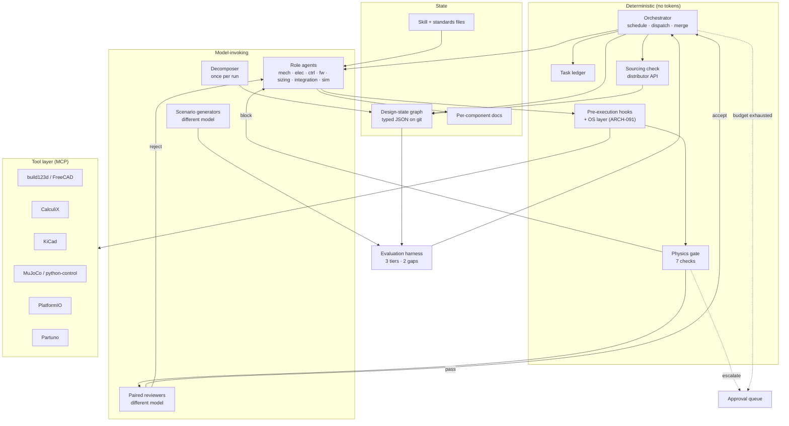

# 02 — Architecture Specification

**Status:** draft 1
**Owner:** Yasin Hessnawi
**Companion:** thesis chapter `Architecture`, which carries the justification. This document carries the implementable detail and is executable without it.
**Convention:** every decision carries an ID `ARCH-nnn`, its dependencies, a cadence, and an acceptance test. Nothing in this document is advice. If an item cannot be executed as written, it is a defect in the item.

---

## S0. Conventions

| Field | Meaning |
|---|---|
| **Decision** | What is built. Imperative, no hedging. |
| **Depends on** | IDs that must exist first. `—` means no dependency. |
| **Cadence** | `once`, `per subtask`, `per module`, `per run`, `weekly`, `on change`. |
| **Acceptance** | The observable that proves it works. |
| **Defer** | Present only where the item is deferred past the first slice. |

**Blocking vs warning.** A *block* halts the pipeline and returns to the producing role. A *warning* is written to the graph and surfaced at the next gate up. No check is advisory.

**Model separation rule.** Three roles must not share a model instance with the implementer: the reviewer, the held-out scenario generator, the validation scenario generator. Enforced at dispatch, not by convention.

---

## S1. Principles

### ARCH-001 — Orchestrator interface and first-slice binding
**Decision.** The orchestrator implements one interface: read the ledger and the graph, emit the next action, emit the merge decision. Two bindings exist. The **deterministic** binding is Python, calls a model exactly once per run at decomposition, and spends zero tokens on scheduling, dispatch, merge or reconciliation. The **model-in-loop** binding makes those same decisions with a model reading the ledger and graph at each step. Gate ordering, hook enforcement and reviewer invocation live outside the interface in both bindings and cannot be skipped by either.

The deterministic binding is the first slice. The model-in-loop binding is a deferred ablation (ARCH-140, ARCH-152).
**Depends on.** —
**Cadence.** once
**Acceptance.** Deterministic binding: token accounting for a full run shows zero tokens attributable to routing decisions. Both bindings: a run cannot reach merge without a gate result and a review result in the ledger, where the review result is a pass or a person's approve bound to the merged commit (ARCH-133).

### ARCH-002 — State outside context
**Decision.** No fact required after the current subtask lives only in an agent's context. The design-state graph, the task ledger and the specifications are files. Agents re-read rather than remember.
**Depends on.** ARCH-010, ARCH-012
**Cadence.** per subtask
**Acceptance.** Killing an agent session mid-task and restarting it loses no project state.

### ARCH-003 — Enforce, do not request
**Decision.** Any constraint expressible as a deterministic check moves from the prompt into a pre-execution hook.
**Depends on.** ARCH-090
**Cadence.** on change
**Acceptance.** Every constraint in every standards file is either hook-enforced or explicitly listed as judgement-only in S9.

### ARCH-004 — Physics gates, does not advise
**Decision.** The physics layer blocks. It runs before the reviewer, not after.
**Depends on.** ARCH-080
**Cadence.** per subtask, per module, per run
**Acceptance.** A deliberately unit-inconsistent artefact never reaches a reviewer.

---

## S2. Component structure



### ARCH-005 — Session isolation
**Decision.** Every agent session runs in its own git worktree. One agent writes one module. The orchestrator owns commit and merge: a role session runs no git command at all, and git's own files in its worktree are protected from it (ARCH-090). Every git command the harness runs on a repository a session could write is pinned to a verified git directory and ignores any setting, attribute or history-shaping file that repository carries, because a session that can write those files could otherwise steer what the harness commits or reads.
**Depends on.** ARCH-001
**Cadence.** per subtask
**Acceptance.** Two concurrent sessions cannot produce a merge conflict on the same file. A git invocation from a role session is refused, through any wrapper or shell form the hooks can see.

**Registered direction — a product core separable from the thesis machinery.** Not yet a numbered decision. The evaluation harness, the experiments, the held-out tier, the benchmark arms and the research instrumentation exist to measure the system; the orchestrator, graph, hooks, gate, reviewers and their tools are the product. After the thesis the product may continue as an open-source tool with the measurement machinery removed, so the dependency runs one way only: evaluation code may import product code, and product code never imports evaluation or experiment code. New work keeps thesis-only features in their own packages and behind their own flags. A rule that exists only to keep a number honest, such as refusing a reportable run that lacks the OS layer (ARCH-091), lives on the evaluation side, so removing that side changes no product behaviour. An import-boundary test enforces the rule once the split is drawn; until then it binds new work at review.

---

## S3. Design-state graph

### ARCH-010 — Graph schema
**Decision.** JSON, one file per node, committed. Minimum node shape:

```json
{
  "id": "motor.left",
  "kind": "component | module | requirement | interface",
  "domain": "mechanical | electrical | control | firmware | cross",
  "owner_role": "electrical",
  "quantities": {
    "stall_current": {"value": 2.4, "unit": "A", "source": "datasheet", "written_by": "sizing"}
  },
  "requirements": ["REQ-014"],
  "constrains": ["power.budget", "control.loop_gain", "chassis.mount"],
  "model": "path/to/executable_model.py",
  "geometry_hash": "sha256:...",
  "updated": "2026-09-18T10:02:11Z"
}
```

A quantity may also name the simulation record it was read off and the extractor used to read it (ARCH-146). The field is optional and left out when absent, so a node that names no record is byte-identical to one written before the field existed.

**Depends on.** —
**Cadence.** on change
**Acceptance.** Every numeric quantity in the graph has a unit string. A node with a bare number fails schema validation.

### ARCH-011 — Interface contracts precede implementation
**Decision.** The orchestrator writes every `interface` node at decomposition. A producing agent may read it and may not write it. A hook rejects any commit that modifies an interface node from inside a module worktree.
**Depends on.** ARCH-010, ARCH-090
**Cadence.** once per module, then immutable
**Acceptance.** An agent instructed to relax its own interface fails at the hook, not at review.

### ARCH-012 — Task ledger
**Decision.** Append-only JSONL. One line per subtask with id, spec path, assigned role, attempt count, gate result, review result, merge commit, and the person's decision and its queue item when one acted (ARCH-133).
**Depends on.** —
**Cadence.** per subtask
**Acceptance.** Ledger length equals the number of dispatched subtasks. A skipped task is visible as a missing id, not as an absence.

### ARCH-013 — Divergence detection
**Decision.** Diff the graph after every step. Any node written by a role that does not own it is a blocking failure.
**Depends on.** ARCH-010, ARCH-012
**Cadence.** per subtask
**Acceptance.** Injected cross-role write is caught within one step.

---

## S4. Specifications and reading

### ARCH-020 — Mandatory reading hook
**Decision.** A hook that runs before every tool call lists the required files and refuses every call other than reading them until each has been read in full, at its current content, in that session. The check cannot sit in a session-start hook, because on the agent runtime this architecture uses such a hook announces but cannot refuse. Required set: role standards file, module specification, role skill file, interface contracts touching the module.
**Depends on.** ARCH-090
**Cadence.** per subtask
**Acceptance.** A session that skips a required read cannot make a tool call.

### ARCH-021 — Research phase, switchable
**Decision.** Triggered when a specification names a component or standard absent from the knowledge layer. Findings written to the component document under `## Research`. Flag `--research=on|off|observe`.
**Depends on.** ARCH-020, ARCH-140
**Cadence.** per subtask
**Acceptance.** Running the same brief with the flag off changes only research behaviour, and the delta is attributable.

### ARCH-022 — Specification contents
**Decision.** Every spec file carries: component id, position in decomposition, requirements with success criteria, interface contracts, ordered task list, assigned roles, required reading, deferral markers.
**Depends on.** ARCH-010
**Cadence.** once per module
**Acceptance.** A coding agent handed only the spec and its required reading can begin without asking a question.

### ARCH-023 — Context split
**Decision.** Always loaded and held to the ceiling: the cross-domain standards file, the role's own standards file and the role's skill file. Required reading but not held to the ceiling: the module specification and the interface contracts (ARCH-020). Retrieved on demand: datasheets, standard clauses, prior close-out summaries.

The module specification is outside the ceiling because the ceiling's remedy, trimming a curated file, applies only to content a person curates; a specification's length follows the module's real complexity, and one fixed number cannot bound both without being too loose for the one or too tight for the other.
**Depends on.** ARCH-020
**Cadence.** per subtask
**Acceptance.** The always-loaded set stays under one agreed ceiling, measured in bytes and passed as a recorded run parameter; breaching it is a defect in the standards or skill file, not a reason to raise the ceiling.

---

## S5. Control loop

### ARCH-030 — Loop stages and repair budget
**Decision.** Eight stages, in order: resolve task → spawn worktree session → verify reading → implement under hooks → physics gate → paired review on full trajectory → accept and merge, or reject with repair instruction → diff ledger and graph.
Repair budget is **three attempts**. Attempt 1 rejection returns the finding. Attempt 2 returns finding plus failing check and numeric output. Attempt 3 escalates to the human with all three trajectories attached. A person may order one further fix after a review that blocked (ARCH-133); it is outside the three and is always the last attempt.
**Depends on.** ARCH-005, ARCH-020, ARCH-080, ARCH-060
**Cadence.** per subtask
**Acceptance.** No subtask consumes more than three implementation attempts without appearing in the approval queue.

### ARCH-031 — Gate ordering
**Decision.** Physics gate runs before review. Rejected work is never reviewed.
**Depends on.** ARCH-080
**Cadence.** per subtask
**Acceptance.** Review token spend on gate-failed artefacts is zero.

---

## S6. Roles

### ARCH-050 — Domain role definitions

| Role | Owns | Tools | Skill file contains | Reviewed against | Hands off to | First slice |
|---|---|---|---|---|---|---|
| Design | Concept, decomposition, trade-offs | graph, requirement templates | decomposition patterns, abstraction levels, requirement phrasing | requirement coverage, traceability | all | automated |
| Mechanical | Geometry, sizing, mounting, DFM | build123d MCP, CalculiX, TraceParts | material table, fastener rules, wall-thickness and radius minima, DFM checklist | geometric validity, sizing margin, DFM pass | sizing, integration, manufacturing | generated, **human sign-off on sizing** |
| Electrical | Component selection, power budget, wiring, connectors | Partuno, KiCad MCP, datasheets | connector conventions, derating rules, power-budget template | schematic DRC clean, budget closes, parts sourceable | sizing, firmware, integration | automated |
| Control | Plant model, controller, stability | python-control, MuJoCo, Simscape | plant-model templates, PID and LQR selection rules, margin thresholds | closed-loop stable in sim, margins met | sizing, firmware, simulation | automated, **human sign-off on stability margin** |
| Firmware | Drivers, real-time loop, HAL, on-target test | PlatformIO, Arduino CLI, HIL rig | timing budget rules, HAL conventions, driver patterns | compiles, timing budget met, on-target test passes | integration | automated |

**Depends on.** ARCH-010, ARCH-020
**Cadence.** per module
**Acceptance.** Each role's skill file exists and is non-empty before that role is ever dispatched.

### ARCH-051 — Cross-cutting roles

| Role | Owns | Type | First slice |
|---|---|---|---|
| Sizing | Every quantity constraining more than one domain | agent | automated, exclusive write |
| Integration | Interface satisfaction, end-to-end behaviour, completion declaration | agent | automated |
| Simulation | Validation environment, scenario tiers | agent | automated |
| Requirements | Spec authoring below module level | agent | automated |
| Manufacturing docs | Drawings, tolerances, PMI | agent | **deferred**, restricted subset only |
| Sourcing | BOM validation against real availability | **deterministic step, not an agent** | automated |
| Knowledge curation | Skill and standards files | **human** | human |
| Red team | Adversarial attack on the design | agent | **deferred** |

**Depends on.** ARCH-050
**Cadence.** per run
**Acceptance.** No quantity marked `cross` in the graph is written by a role other than `sizing`.

### ARCH-040 — Arbitration rule
**Decision.** Fixed precedence, no negotiation. Physics gate outranks every domain. Sizing outranks any single domain on a shared quantity. Unresolved after both → approval queue with both positions and the disputed edges.
**Depends on.** ARCH-051, ARCH-130
**Cadence.** on conflict
**Acceptance.** No conflict resolution path involves two agents exchanging messages.

---

## S7. Reviewer topology

### ARCH-060 — Paired specialist reviewers
**Decision.** Each producing role has a paired reviewer with its own rubric and knowledge file, running a different model. Reviewer reads the **full trajectory**, not only the artefact.
**Depends on.** ARCH-050
**Cadence.** per subtask
**Acceptance.** Dispatch refuses to run a reviewer on the same model string as the implementer.

### ARCH-061 — Implementation order
**Decision.** Control and firmware reviewers first, since those roles are automated first. The electrical and mechanical reviewers follow ahead of their roles, because the injected-error instrument of ARCH-083 sends each domain's artefacts to that domain's reviewer alone, and a domain with no reviewer stops the instrument before any review. Others follow their roles. A reviewer's existence never admits its role: a run refuses to start if it names a role absent from the role register, and a role enters the register only with its standing sign-offs (ARCH-130) wired.
**Depends on.** ARCH-060
**Cadence.** once
**Acceptance.** Every automated role has a paired reviewer before it is dispatched unsupervised. A run naming an unregistered role is refused before decomposition, whether or not a reviewer for that role exists.

### ARCH-062 — Rubric contents
**Decision.** Each rubric lists: acceptance criteria from the spec, the domain's standard violations, the known antipatterns from the skill file, and an explicit instruction to report reward-hacking indicators (feature isolation, hard-coded values, disabled checks).

Each rubric also:
- **Names what the automated checks cover, and does not tell the reviewer to skip them.** It states that a claim the checks passed is no evidence, and tells the reviewer to judge units, magnitudes, balances and follow-ups by reading. It says nothing about which ran first. In the loop the gate runs first (ARCH-031); in observe runs and in the injected-error instrument the reviewer judges work the gate has not stopped, and a rubric that deferred to the gate would hide exactly the errors ARCH-083 counts.
- **Carries a no-specification clause.** Work submitted without an issued specification is a proposed revision of the design on its own. Section 1 is then one line, whether the revision is consistent with the design it changes and with the rubric, answered met or unmet, never "not evaluable"; the missing specification is not a defect. Without the clause a reviewer can block every such revision for want of a specification, which measures nothing about reviewing.
- **Charges the revision only with what it wrote.** A check that fails only on values the revision did not write is recorded as a non-blocking note; one involving any value it wrote, including a follow-up it failed to make, is judged normally.
- **Treats "not evaluable" as blocking**, with each role's list of what a judgement needs stated explicitly.
**Depends on.** ARCH-060, ARCH-100
**Cadence.** on change
**Acceptance.** Rubrics are versioned; a rubric change is a ledger event. A promoted rubric's change goes through staging and human promotion with a version bump, and an experiment pins the rubric versions it ran. With no issued specification, the answer schema admits exactly one Section 1 line, and a verdict that breaks it is refused.

### ARCH-063 — Maintenance cost, stated
**Decision.** Each pair adds one rubric file and one knowledge file to maintain, and roughly doubles review token spend against a single generalist reviewer. Accepted because reviewer drift toward one issue class is a known failure and because a generalist cannot carry five domains of standards within the context budget.
**Depends on.** ARCH-060
**Cadence.** —
**Acceptance.** Cost recorded per run so the trade is visible rather than assumed.
**Measured so far.** One control attempt, one review per arm: the paired review used 1.63 times the tokens and 1.44 times the list-price cost of a generalist reviewer given the same material, 1.46–1.63 and 1.27–1.44 once a version difference between the arms is removed. Its cost figures predate the per-call pricing of ARCH-145 and have not been re-priced, so the token ratio is the firmer. One measurement on two harness versions does not support "roughly doubles"; the expectation stands unconfirmed until a comparison at one commit with several runs per arm, costed on the runtime's own totals.

---

## S8. Physics layer

### ARCH-080 — Mandatory checklist

| # | Check | Tool | Runs at | Returns | On failure |
|---|---|---|---|---|---|
| 1 | Unit consistency | `pint` | subtask | offending expression, both unit sides | **block** |
| 2 | Magnitude plausibility | bounds table in skill file | subtask | value, expected range, source of range | **block** |
| 3 | Static equilibrium and load path | closed form, CalculiX | module | reaction forces, unbalanced residual | **block** |
| 4 | Power balance | `sympy` + graph arithmetic | module, system | deficit in W, contributing nodes | **block** |
| 5 | Energy and mass conservation | `sympy` | module | imbalance, terms | **block** |
| 6 | Thermal budget | graph arithmetic | module, system | margin in K or W | warn at module, **block** at integration |
| 7 | Cross-domain propagation | graph traversal | system | list of unwritten constrained edges | **block** |

**Depends on.** ARCH-010, ARCH-004
**Cadence.** per subtask (1–2), per module (3–6), per run (4, 6, 7)
**Acceptance.** Each check has a unit test with a deliberately failing input and a deliberately passing input.
**Known hazard.** Checks 1 and 2 hand a role-written unit string to the unit registry, which evaluates any arithmetic in it exactly. A bound on the string's length does not bound that work: a twelve-character exponent tower kept one process busy until a CPU limit killed it, and the gate runs inside the orchestrator's process with no time bound, so one proposal could stall a run without the stall being charged to any attempt. The remedy, a bounded unit spelling checked before the registry sees the string, as simulation records already apply (ARCH-146), is a change to the gate and is not yet made.

### ARCH-081 — Gate is not editable by agents
**Decision.** The gate directory is protected by a pre-execution hook. No agent session may write to it.
**Depends on.** ARCH-090
**Cadence.** per subtask
**Acceptance.** An agent instructed to modify the gate fails at the hook.

### ARCH-082 — Propagation check definition
**Decision.** For any node whose quantities changed, traverse `constrains`. For each target, if no quantity on that target was rewritten in the same commit and no explicit `no_change_justified` annotation exists, fail.
**Depends on.** ARCH-010, ARCH-080
**Cadence.** per run
**Acceptance.** Swapping a motor for one with different stall current, without touching current budget, loop gain or mount inertia, fails the check.

### ARCH-083 — Catch accounting
**Decision.** Every gate event logs: check number, value, node, module, gate mode, the version of the kind catalogue that judged it, and `reviewer_had_passed: true|false|null`. `null` means no review of that artefact exists: in the blocking loop the gate runs first and a blocked artefact is never reviewed (ARCH-031), so there the field is honestly empty. It is informative in observe runs, where the reviewer runs after a gate that does not block, and in the injected-error instrument, where the reviewer sees each artefact alone and first. The headline research quantity is the count of physical errors caught where `reviewer_had_passed` is true.
**Depends on.** ARCH-080, ARCH-060
**Cadence.** per subtask, aggregated weekly
**Acceptance.** The quantity is queryable from the ledger in week one. **If it trends to zero, the contribution is weaker than claimed and the thesis reports that.**

---

## S9. Hook enforcement

### ARCH-090 — Enforced surface

| Constraint | Hook point | Enforceable |
|---|---|---|
| Protected paths, **put back** if changed: the gate, interface nodes, `.env`, frozen experiment results and criteria, the graph store's whole directory, the hooks' own code and settings, the harness checkout, git's own files and each worktree's `.git` pointer, the run's copy of the record writer (ARCH-146) | PreToolUse (file tools and shell parser), then a sentinel after every call | yes, two layers |
| Protected paths, **refuse-only**: session records, the approval-queue decisions file, the state and config directories, the simulation-record outbox (ARCH-146) | PreToolUse | yes for the file tools and for what a command's own text decides; the residual below is closed only by ARCH-091 |
| Reads of the held-out tier, answer keys and review material | PreToolUse | yes for literal paths, including paths inside here-document and here-string bodies; the residual below is closed only by ARCH-091 |
| Unit consistency on committed expressions | PreToolUse | yes |
| Mandatory reading complete | PreToolUse (ARCH-020) | yes |
| Git from a role session: none at all (ARCH-005) | PreToolUse | yes |
| Tools outside the session's closed tool list | session settings | yes |
| Cross-role graph write | PreToolUse, and the store again when the orchestrator applies proposals | yes |
| Schema validity of graph writes | PreToolUse | yes |
| Correctness of engineering judgement | — | **no, reviewer + gate** |

**The shell parser's rule.** The parser resolves exactly what a command's own text decides, following braces, quoting forms, literal in-call variables and literal directory changes across the readings of every common shell, and refuses only what it cannot read that way at a stated bound. It never refuses wholesale on doubt, because a layer that refuses ordinary commands is switched off in practice. **Its residual is what only running decides:** values set at run time (substitutions, `read`, special and positional parameters, arrays, `IFS`), the directory after a `cd` through a substitution, scripts fed by a pipe, `xargs` or `source`, interpreters fed a program on standard input, paths a program builds from its input, and any command behaviour the parser's rule lists do not name, since no such list is complete. For put-back paths the sentinel undoes what the parser misses. For refuse-only paths and for reads nothing after the parser catches it, which is why ARCH-091 exists.

**Evidence.** Both experiments drive attempts derived mechanically from a pinned public catalogue of Unix-binary file operations, 755 in all, by a rule fixed before any ran. **R-HK-01:** the 230 whose binary was present were all refused before running, and none reached; the other 525 did not run, so the sentinel was never exercised, and every target lay inside the session's own tree. **R-HK-02:** all 755 were driven. None wrote a byte to a protected path, whether the targets sat in the session's tree or in a separate harness checkout reached by absolute path, but one read reached the held-out tier: a held-out path inside a here-document fed to an interpreter, which the parser did not then inspect. The tolerance was zero reach, so the read boundary was not met. Here-document bodies are now scanned for literal paths; the interpreter-on-stdin class stays in the residual. **The held-out read boundary is claimed only on runs where ARCH-091 is present**, and any new figure for it is a new experiment. The sentinel-alone arm stopped at 214 of 755 on a harness guard and is partial.

**Depends on.** ARCH-003
**Cadence.** per tool call
**Acceptance.** Each row has a test. Shell bypass is tested by the pre-registered attempt corpus above and by a parity test that holds every write and read route to the same decision, across real bash, zsh, ksh and dash. A change to the parser is measured for newly refused legitimate commands against recorded ones, and the count is reported.
**Known residuals.** A process a role session leaves running could write a put-back path after the sentinel's last check; review sessions now stop every process they leave, role sessions do not yet. The sentinel puts back startup files in the harness's software environment but not the installed packages beneath them.

### ARCH-091 — OS layer for shell commands
**Decision.** Where the platform provides it, every shell command of an agent session runs inside the operating system's sandbox, through the agent runtime's own sandbox, switched on per session in the settings the harness generates. No container and no extra install.
- **Writes** are allowed only in the session's worktree, its own temporary directory and its own home.
- **Every protected path** in the session's registry is denied: for writing, for reading, or both, as the registry says. That includes the held-out tier, answer keys, review material, the harness checkout, other sessions' records, the state and config directories, git's common directory, and the session's own credentials and the sentinel's stored copies.
- **The deny list** is generated by one function from the same registry the hooks read, and a test fails on any protected path the function does not map.
- **Strict mode.** A command cannot be retried outside the sandbox, and a repository's own settings cannot widen it.
- **No silent start.** Where the layer is generated, a session whose sandbox then fails to start does not start.
- **Loud degradation, never refusal by the core.** At run start and at every resume the harness probes for the layer. Where the platform cannot provide it, the run proceeds and records the layer as absent with the reason, in the run's manifest and event log, on standard error and in the operator UI; on Windows this reads "no OS protection". There is no flag that hides it.
- **Evaluation runs refuse without it.** A reportable run whose sessions have a shell is refused when the layer is absent, with no override. Review-only sessions, which have no shell, are outside this rule. The rule lives with the evaluation machinery, not the core (S2's registered direction), so the product may run without the layer, with the warning, and a measurement may not.
- **The runtime is pinned** to a version carrying the sandbox fixes the layer depends on; older pinned versions stay for reproducing old runs and record the layer as absent.

The parser of ARCH-090 resolves what a command's text decides; it cannot see what only running decides, and for reads and refuse-only paths nothing after it would. An operating-system rule is enforced on the running process whatever the command's text, so it closes the class the parser's rule lists can only name.

**Depends on.** ARCH-090, ARCH-003
**Cadence.** per session; probed at run start and at every resume
**Acceptance.**
- With the layer on, commands the parser cannot judge reach no protected path: an interpreter fed a program, a path built at run time, a symbolic link, a pipe-fed shell, a hard link.
- With the layer off, the same commands are recorded as reaching, which shows the probe can see a reach.
- Ordinary builds, tests and read-only operations in the worktree still succeed.
- A run without the layer records "absent" with its reason, and a reportable run with shell sessions and no layer is refused before any session starts.

**Known limits.**
- The file tools, the hooks and tool servers run outside the sandbox; ARCH-090's hooks remain their layer.
- A denylist hides only what it names: another checkout of this public repository on the same machine is not in any run's registry, so held-out material is kept only where it is registered and never in git.
- A per-path rule cannot tell one program from another, so a path a script may write, such as the simulation-record outbox, is protected by its collector rather than by this layer (ARCH-146).
- Hard links that already exist are not undone.
- The network is unchanged: in the permission mode role sessions run in, the sandbox's proxy lets every host through. The setting is recorded with the run.
- The layer is absent wherever the platform cannot run it: native Windows; a Linux host that lacks the sandbox's packages or forbids the user namespaces it needs, including the project's current evaluation server. Runs with shell sessions that must be reportable therefore run where the layer is present.

---

## S10. Knowledge and skills

### ARCH-100 — Human-gated skill promotion
**Decision.** Successful episodes emit candidate skills, failures emit candidate antipatterns, both to `staging/`. Nothing enters the retrievable library without human promotion.
**Depends on.** ARCH-050
**Cadence.** per subtask (emit), weekly (promote)
**Acceptance.** Library contents are a strict subset of promoted items.
**Defer.** Automatic promotion is a later phase, contingent on staging data showing promoted skills raise measured pass rate.

### ARCH-101 — Standards files
**Decision.** One per domain, read before any work in that domain. Contains the rules that apply to every task, not to one. Human-gated rather than human-written: each rule is drafted from cited literature by agents kept blind to the evaluation corpus, reviewed adversarially, and enters only on a person's promotion (ARCH-100). Skill files and reviewer rubrics follow the same path.
**Depends on.** ARCH-020
**Cadence.** on change
**Acceptance.** Every automated role has a standards file before first dispatch.

---

## S11. Manufacturing output

### ARCH-110 — Restricted generation scope
**Decision.** Generate: standard views, dimension scheme, a rule-checkable GD&T subset (datum from largest planar face, position tolerance on holes), ISO 286 fit selection from functional tags on the graph, STEP AP242 with semantic PMI. Check each with a deterministic syntax and completeness validator. **Human sign-off required on every drawing.**
**Depends on.** ARCH-010, ARCH-051
**Cadence.** per component
**Acceptance.** A generated drawing passes the validator and a machinist can produce the part from it.
**Defer.** General tolerancing from functional intent. No measured automation exists for it.

### ARCH-111 — Staleness by hash
**Decision.** Record `geometry_hash` when a drawing is produced. Compare on every graph change. Mismatch marks the drawing stale and regenerates. Never patch.
**Depends on.** ARCH-010, ARCH-110
**Cadence.** on change
**Acceptance.** Changing a dimension invalidates the drawing within one step.

### ARCH-112 — Assembly manual
**Decision.** Assembled from per-component close-out documents, BOM and wiring definition. Validation is the physical build by mechatronics students working from the manual alone.
**Depends on.** ARCH-110, ARCH-120
**Cadence.** per run
**Acceptance.** Students complete the build without consulting the design team. Failures are logged as manual defects, not build defects.

---

## S12. Buildability

### ARCH-120 — BOM validation
**Decision.** Every line validated for availability, unit price, MOQ, order multiple and **lead time to Norway**. Any failure returns the line to the electrical role as blocking. Norway sits outside the EU customs union, so VAT and customs handling apply to non-EEA imports and are recorded per line.
**Depends on.** ARCH-051
**Cadence.** per run
**Acceptance.** Every BOM line is purchasable and deliverable inside the project timeline, or the design changes.

### ARCH-121 — No autonomous purchasing
**Decision.** The sourcing tool may query and may not order.
**Depends on.** ARCH-120
**Cadence.** —
**Acceptance.** No order-placing capability is exposed to any agent.

**Registered direction — parts the user has or can make.** Not yet a numbered decision. The pipeline assumes every component is found and bought; a person often already has a part, or can make one. Once decomposition has produced the component list, the person marks each component as one of three:
- **have it:** its real specifications become fixed inputs, with user-declared provenance;
- **make it:** a custom part, with the constraints the person states;
- **find it**, the default: sourced and sized as today.

The choice is an approval-queue decision (ARCH-130), so it is recorded like any other. Sourcing (ARCH-120) skips parts marked have or make, and sizing (ARCH-051) treats them as fixed. The physics gate still checks them: a declared part is an input to the design, not an exemption from it. It touches decomposition, sizing, sourcing and the operator UI, and becomes a numbered entry when its specification is registered.

---

## S13. Human oversight

### ARCH-130 — Approval queue item
**Decision.** One queue. Its sources: gate escalation, exhausted repair budget, unresolved arbitration, a review that blocks on a defective specification, a review that ends without a verdict (never counted as a pass or a fail), and an escalation decision (ARCH-131). Plus standing sign-off on mechanical sizing, control stability margin and every drawing. No code path yet produces an unresolved arbitration (ARCH-040), so that source is specified and has no input.
Each item carries: decision required, artefact diff, triggering finding, the three most relevant quantities, link to full trajectory. Each item also names the attempt and commit it concerns, and what approve and reject will do to it and why (ARCH-133).
**Depends on.** ARCH-030, ARCH-040
**Cadence.** as raised
**Acceptance.** Median review time under one minute. **Items that cannot be compressed to that indicate the decomposition is too coarse and are logged as such.**

### ARCH-131 — Escalation decision interface
**Decision.** The question "does this subtask go to the approval queue" is asked through one interface, `decide(question, state) -> (answer, confidence, backend_id, latency_ms)`. Question kinds are `yes_no`, `choice` and `score`; only `yes_no` is exercised in the first slice. `state` is the structured subtask record at the end of an attempt — the ledger line, the gate result, the reviewer verdict, the changed-node summary. No free text in the first slice.

A confidence **below 0.8 routes to ARCH-130 whatever the answer**. The threshold is a property of the interface, not of a backend, so every backend is judged on the same routing rule.

The default binding is `rules`: exactly the deterministic conditions ARCH-030 and ARCH-040 already specify, emitted at confidence 1.0. Every other binding is an ablation arm and enters only through ARCH-132.

**Relationship to ARCH-001.** A binding is admissible only if it spends **zero tokens on the decision** and its weights or rules are frozen at a recorded version. This is a deliberate and bounded carve-out from the invariant: ARCH-001 forbids a model deciding *what runs next and whether to merge*, because such a model can be argued out of routing and there is no downstream check on it. Escalation is a different decision with an asymmetric failure mode — over-escalating costs a minute of human attention, under-escalating is still caught by the physics gate and the reviewer, both of which run regardless. The carve-out does not extend to scheduling, dispatch, merge or reconciliation, and no backend may read or write the design-state graph.

**The state's schema.** It was deliberately left undefined until its sources existed, so that the architecture would not inherit a study's field names from the only structured state then available, a synthetic one. Its trigger has fired: `state` is now a frozen record with no free text, in which every field is copied from one recorded line: the task ledger line (ARCH-012), the line that ended the attempt, the structured parts of the gate result (ARCH-080) and of the reviewer verdict or its absence (ARCH-060), and the change check, which names the nodes the attempt proposed. Replay refuses a recorded state that differs from the one rebuilt from the lines before it. The question is asked at every attempt end that did not merge, and not after a merge. **Every row in ARCH-132 whose evidence was gathered on a generated state says so**, because a backend measured on a shape other than this one has been measured on a proxy.

**Depends on.** ARCH-012, ARCH-030, ARCH-040, ARCH-060, ARCH-080, ARCH-130
**Cadence.** per subtask, at the end of an attempt that did not merge
**Acceptance.** With the `rules` binding the approval queue receives exactly the items it receives with no interface at all, proven by a test that runs both. Every call records answer, confidence, backend id and latency as one line in the run's event log, so a backend's behaviour is auditable after the fact rather than at the time. The task ledger (ARCH-012) is the event log's fixed-shape projection and is byte-identical with and without the interface. A route forced by the repair budget, or by a blocked or verdict-less review, cannot be removed by any backend; a backend can only add escalations.

### ARCH-132 — Escalation backend register
**Decision.** Bindings enter by name, with a status and an entry condition. A backend enters only on a pre-registered experiment's pass, and its row cites that run.

| Backend | Status | Entry condition and evidence |
|---|---|---|
| `rules` | **ships**, the default | none; it is ARCH-030 and ARCH-040 expressed through the interface |
| `llm` | **listed, off and refused** | spends a model call on each decision, which ARCH-131's admission rule (zero tokens on the decision) forbids. It is listed so the refusal is on record rather than silent; enabling it would first need that rule changed, as its own decision |
| `tsetlin` | **contingent, parked** | R-TM-01, four runs. Calibrated humility off-distribution held in every run and no baseline reproduced it; accuracy parity did not, and clause legibility failed twice. Carries a provenance caveat: the selected region was first seen in an earlier run's post-hoc frontier. Rerun as a baseline arm in R-LAYA-01, where it was the only arm to satisfy calibration, humility and selective accuracy together, **and only uncalibrated**: with its temperature fitted on in-distribution data, its humility on the unseen-domain set falls below the bar and its accuracy on the decisions it keeps off distribution falls from about 0.99 to 0.74–0.81. That run reused this generator and configuration, so it is a transferability check of a known answer rather than independent evidence, and its latency on the orchestrator's machine is unmeasured |
| `laya` | **parked** | R-LAYA-01. Fine-tuned, it answers every state at confidence 1.0 and does not become less confident off distribution under any temperature configuration: the humility criterion fails on both off-distribution sets, which is a pre-registered kill criterion, and accuracy on the decisions it keeps falls to 0.45 on one of them. In-distribution calibration passed, and is uninformative for a model that reports no uncertainty. Measured on a generated state, not the system's own (ARCH-131) |

**Depends on.** ARCH-131, ARCH-140
**Cadence.** on change
**Acceptance.** Only `rules` is enabled by default. Every other binding is an independent flag under ARCH-140 and every flag combination runs to completion. A row whose experiment has not passed reads *contingent*, and the system refuses to enable it outside an ablation run. **No entry condition admits a backend on in-distribution calibration alone.** A model that reports no uncertainty passes a calibration criterion whenever it is accurate on familiar data, which R-LAYA-01 demonstrated, so calibration is always paired with humility measured off distribution. **A calibration step is judged by its effect off distribution too**: in the same run, fitting a temperature on in-distribution data improved one arm's calibration and made it measurably less safe where the data were unfamiliar.

**Registered direction — an AI collaborator as a third party.** Not yet a numbered decision; more context is to come before it is specified. A chat model that works beside the orchestrator, not as it:
- **It acts only through an enumerated set of tool calls**, the same actions a person has. It starts a run after interviewing the person for the brief, applies requested changes (to the ledger, a node, a specification, a running model) at the orchestrator's safe points, and later operates tools and simulations.
- **Every action is recorded as the collaborator's**, quoting the request that caused it, so a fault can be attributed to the orchestrator, an agent, the collaborator or a person.
- **It never has more than a person has:** it cannot skip the gate or a review, and cannot touch frozen material.
- **It is independent of the orchestrator binding.** Deterministic against model-in-loop (ARCH-140) is decided by evaluation and does not change the collaborator, nor the reverse. It decides nothing the orchestrator decides, so it is not an exception to ARCH-001.

The channel by which a role agent's question reaches a person moves under it. It becomes a numbered entry when its specification is registered.

### ARCH-133 — What a queue decision does
**Decision.** A person decides an approval-queue item (ARCH-130) with a verb, approve or reject, and a note; a rejection needs its note. The orchestrator takes each decision into the run's event log at the first point where no attempt is in progress, and acts on it there, in code. Nothing a person decides is carried out by a model, and nothing is carried out while a session runs.

*Approve* merges the attempt the item names, exactly that commit, through the same merge the loop uses for a reviewed attempt: its proposals applied under the design-state store's own refusals, the run branch checked, the commit merged, the graph diffed. An approve may merge only an attempt that every automated check let through: its reading verified, its change check clean, its gate result one the run's gate mode merges, and every trajectory of the subtask still as sealed. It may merge none when a review of any attempt of the subtask confirmed a reward-hacking indicator, or when the scan that runs before review found one in the streams of any attempt no review judged, since an earlier attempt's work is in the commit an approve merges. What a person overrides is the review alone: a verdict that failed, never came, or blocked on the specification. A physics-gate failure is never overridden by an approve, at subtask or at system scope, because a gate a person can wave through no longer blocks (ARCH-004, ARCH-040). On any other item an approve is recorded and merges nothing, and the item states what each verb will do, and why, before it is decided.

An approve binds to what was shown. The item names the attempt's commit and carries its diff; the decision carries the digest of the item's line as shown, and each linked trajectory's seal status is checked again under the queue's lock. A queue line is read only in the one form its writer writes, and a decision's free text is exactly its verb and note, so a line cannot mean one thing to the person and another to the run. When the orchestrator takes the decision it rebuilds the item from the event log with the builder that listed it and refuses any difference, so a person cannot be shown one attempt, stream or finding and have another merged; a mismatch halts the run. A decision without that binding is recorded and acts on nothing.

*Reject* spends the attempt. With the repair budget not exhausted (ARCH-030), the next attempt starts from the repair template with the person's note quoted as the finding. With no attempt left, the subtask ends rejected. A rejection of an attempt whose review blocked on the specification gets one fix instead: a fresh session of the same role and model, in the subtask's worktree, told the review's verdict and the person's note in a fixed template, and nothing of the earlier session. It runs under the same enforcement as any role session, and is gated and reviewed like any attempt, its reviewer told that it is the fix a person ordered and what it was told. If it is not merged, the subtask ends rejected, with no escalation question; there is no second fix. The note and the quoted verdict are bounded, recorded verbatim, given to the next reviewer, and refused, halting the run, if they show material no session may read. The note's bounds are held wherever a decision line is read, not only where it is written: its length in characters and lines, and no control or format character, so the text a person sees is the text a session reads. A rejection whose ordered session's reviewer could not read what that session is told whole ends the subtask instead, before any session, and the decision taken says so. Neither changes a specification, interface node, required reading or hook.

When every planned subtask is merged or ended, the integration call runs again on the run branch as it now stands, so an approved merge is judged at system scope like any other. A run that has ended is resumed to take its decisions, and only after every session it left behind has been stopped and its record read. A run that acts on decisions runs only inside the OS layer (ARCH-091), the one layer that keeps a session's own shell from the decisions file: it is refused at its configuration, and at every run and resume, where the layer is absent or unrecorded. Behind that, the decisions file is held append-only: each session's start records the digest of the file as it then was, and a decision is taken only while every such prefix is unchanged; otherwise the run halts. A decision written while a session ran without the layer, if one ever did, acts only once the operator confirms it on the command line. Whether a run acts on decisions is a recorded run parameter, `act` or `record`; a run recorded before the parameter existed reads as `record`, and the evaluation harness runs with `record` and refuses a reportable run that acts, so no measured outcome is changed by a decision taken during it.

**Depends on.** ARCH-001, ARCH-030, ARCH-040, ARCH-060, ARCH-080, ARCH-091, ARCH-130
**Cadence.** as decided, at a subtask boundary
**Acceptance.** An approved attempt is merged by the same merge function, with the commit the item names, and the integration call then runs; a test does this on a run that had already ended, with the real loop, git, store and gate. An approve on an attempt the gate failed, the change check refused, or on a subtask any of whose reviews confirmed a reward-hacking indicator merges nothing, each proven by its own test and a mutation of its guard. An item rewritten before it was decided halts the run at take. A rejection with attempts left dispatches exactly one further attempt whose repair instruction quotes the note; with none left, none. A rejection after a blocked review dispatches exactly one fix session, installed as a role session is, whose acceptance merges and whose rejection ends the subtask. No decision is taken between a session's spawn and its attempt's end, nor before a resume has read every leftover session's record, nor from a decisions file rewritten beneath a session's start; a run that acts is refused without the OS layer. Every decision taken is one line in the event log naming the item, the digest shown, the verb and what it did.

---

## S14. Evaluation

### ARCH-140 — Ablation switches
**Decision.** Independent flags, each disableable without the others: research phase, physics gate (`on|off|observe`), paired reviewers, skill library, hook enforcement, prompt optimiser, orchestrator (`deterministic|model-in-loop`).

**Orchestrator variants.** The deterministic variant is the first slice and is built first, since the evidence favours it and it is testable against injected errors before any agent exists. The model-in-loop variant is a deferred ablation: same graph, same ledger, same hooks, same gate ordering, but scheduling, dispatch and merge decisions are made by a model reading the ledger and graph at each step rather than by code. It must not be able to skip the physics gate or the reviewer, so gate ordering stays in code in both variants. What varies is only who decides what runs next and whether to merge.

**Depends on.** all of S1–S10
**Cadence.** per run
**Acceptance.** Every flag combination runs to completion.
**Priority.** The physics gate in `observe` mode is the most important single ablation, since ARCH-083 is only interpretable against a run where the gate watches without blocking. The orchestrator ablation is the second most important, because no study has measured deterministic against model-driven coordination on a design task whose artefact is physical. It is run only if time allows after the first slice is complete and measured.

### ARCH-141 — Three scenario tiers

| Tier | Seen by | Purpose | Regenerated when |
|---|---|---|---|
| Visible | implementer | iteration during a subtask | requirements change |
| Validation | **prompt optimiser only** | optimisation objective | requirements change |
| Held out | **nothing until measurement** | both reported gaps | ever exposed |

All three generated by a model different from the implementer. All three **compose requirements** rather than test them singly, since feature isolation alone produces a gap without tampering.
**Depends on.** ARCH-051
**Cadence.** per run
**Acceptance.** Held-out set is never read by an implementer or an optimiser. Exposure triggers regeneration, logged.

### ARCH-142 — Two headline gaps, weekly from week one
**Decision.**
- **Reward-hacking gap** = visible pass rate − held-out pass rate. Measures satisfying the proxy rather than the requirement.
- **Optimiser-overfit gap** = validation pass rate − held-out pass rate. Measures whether the optimiser has begun climbing the evaluation.

A rising second gap triggers regeneration of the validation tier. It is not a success signal.
**Depends on.** ARCH-141
**Cadence.** weekly
**Acceptance.** Both numbers exist in week one, from however few tasks exist then.

### ARCH-143 — Baseline
**Decision.** Raw coding agent, same brief, same tools, same token budget. No harness, no gate, no reviewer, no spec structure.

**Per role.** The comparison is made for each design role on its own as well as for the whole run: the role under the harness against the raw agent on the same numerically scored tasks, control and firmware first. A whole-run figure alone cannot show which role the harness helps or hurts.

**Published benchmarks.** Published state-of-the-art benchmarks and systems are a primary comparison beside the project's own tasks, reported as a separate external tier and never merged into the three tiers of ARCH-141. Each is run on the benchmark's own split, protocol and scorer, scored numerically, with this baseline also run on that split, so the harness is compared with the published systems and with the bare model under identical conditions.

**No number before its audit.** Before any headline is reported, every existing figure is checked for optimism: unrun attempts, narrowed scopes, single runs, proxy data, costs that read low, components changed after a freeze. A frozen result is never edited; the correction is a new measurement.
**Depends on.** —
**Cadence.** per milestone
**Acceptance.** Baseline is re-run whenever the task set changes, so the comparison never drifts. Each external benchmark result names the split, protocol and scorer it used, and has a baseline result on the same split beside it.

### ARCH-144 — Prompt optimisation scope
**Decision.** Optimises exactly three things: the decomposition prompt, the specification-authoring prompt, the reviewer rubrics. Objective is the **validation tier**. Feedback signal is the reviewer's textual findings, not a scalar.
**Depends on.** ARCH-141, ARCH-140
**Cadence.** per milestone
**Acceptance.** No weights change. No held-out scenario is read.
**Defer.** Entire item is deferred past the first slice.

### ARCH-145 — Observability
**Decision.** Per-step traces, per-check results, token and wall-clock per session, pinned model version strings, seeds, resolved configs, artefact hashes.
- **Cost** is priced call by call, at the cache lifetime each call actually paid, from a dated price sheet that is never edited, and reconciled against the agent runtime's own total. A call whose stream is not the bytes sealed at its session's end, or whose cache lifetime could not be read, is named and priced at the lower rate, and the line says it is a lower bound. Lines priced before this rule charged every cache write at the shorter lifetime and read 21.5–28.8 % low on the runs recomputed; such lines are recomputed, never cited as they stand.
- **The runtime's remote feature-flag state** is recorded with how it was known: observed in the runtime's own output, or off by a documented setting that the version does not report. The two are distinct values, never one.
- **Artefact hashes** include each simulation record's seal and script digest (ARCH-146).

Record, per run, the variance in task ordering and merge decisions across repeated runs with the same seed and brief. This is the reproducibility axis the COBOL comparison used, and it is the primary measurement for the orchestrator ablation.

**Depends on.** ARCH-012
**Cadence.** per subtask; ordering variance per run
**Acceptance.** Any run is reproducible from its recorded configuration: exactly, simulation-record seals included, on a scripted and seeded run; on a real model, which nothing pins, by the sequence of decisions it makes, with artefact-level differences recorded and not scored. Ordering variance is a queryable number for every run, not only for ablation runs. A cost line equals the runtime's own total on every call it could read, or says it is a lower bound.

### ARCH-146 — Simulation records
**Decision.** A simulation's output is a record, kept as evidence beside the run.
- **Format.** One file per run of a simulation, columnar JSON: one x axis (time or frequency) and up to 32 traces, a unit on every axis, finite numbers only, fixed size bounds per record and per session. A bare number is a schema error, as in the graph (ARCH-010). A unit is admitted only in a bounded spelling, and logarithmic and information units are refused, because the unit registry would read a decibel as a power ratio.
- **Provenance.** The record names the script that produced it and every file of code that script loaded, by digest.
- **Writing.** A role's script writes it through a standard-library writer, copied into the run at decomposition, into an outbox that is a refuse-only path (ARCH-090). The writer's copy is a put-back path.
- **Collection and seal.** The orchestrator collects the outbox at session end, before the commit, and seals each record on the session's end line. A record is sealed only when its script and every loaded file lie in the module and are unchanged since it was written. Records never enter git, the review diff or the graph.
- **Binding to the commit.** The change check requires every record the attempt sealed, from every session of the attempt, to have its script and each loaded file at the attempt commit, as regular files with those exact bytes.
- **Linked quantities.** A graph quantity may name the record and the extractor it was read with (ARCH-010). The change check reads the value again with the same extractor and refuses the attempt, before the gate, if the two differ by more than 0.5 % relative, a tolerance fixed before any record existed. The refusal is recorded, and the repair names both numbers. The check is bounded in how many quantities it reads, and fails closed.
- **Review.** The reviewer's packet lists every record, summarised from its own sealed samples, the code each names, and each linked quantity's check; reading the listing is required (ARCH-060).

The outbox cannot be protected by hooks alone: any program a session runs can write any path its user can, and an operating-system rule is per path, not per program (ARCH-091). So the collector, not the hooks, is the authority on what counts as a record.

**Depends on.** ARCH-010, ARCH-031, ARCH-090, ARCH-145
**Cadence.** per session (collect, seal); per attempt (bind, check, listing)
**Acceptance.**
- A changed record is refused on read.
- A quantity that differs from its record never reaches the gate, and costs no gate run and no review.
- A record whose script or loaded code the attempt did not commit with the sealed bytes refuses the attempt.
- A rerun from the recorded configuration reproduces the records' seals; a rerun whose record differs is not exact and names where it parts.
- A node that names no record is byte-identical to one written before this entry.

**Known limits.**
- **The tolerance holds only for values read off the role's own samples.** The check proves that the reported number is the one the recorded samples give, not that the samples resolve the system: on analytic loops a sampled sensitivity peak sat past the tolerance in 3 of 12 cases, by up to 28 % on a loop that was closed-loop unstable. Recording densely around resonances is the skill's instruction, judgement-only.
- **A record proves which committed code it names, not that the code produced the curve.** The writer runs in the role's own process and can be bypassed or misled. Re-running the recorded script in isolation and comparing with the seal closes this, and is the what-if runner's mechanism.
- **Whether a role records a simulation at all** is judgement-only. A quantity that names no record is not checked.

---

## S15. Cost and build order

### ARCH-150 — Cost model
**Decision.** Budget three parallel sessions, repair budget three, reviewer reading trajectories. Reductions taken: cache standards and skill files across sessions; run the gate before the reviewer so rejected work is never reviewed; reserve deep research for components absent from the knowledge layer.
**Not taken:** cutting trajectory reading. Detection AUC falls 0.97 → 0.92 and TPR at 5% FPR falls 0.82 → 0.44 without it.
**Depends on.** ARCH-031, ARCH-060
**Cadence.** per run
**Acceptance.** Cost per full run recorded and trended.

### ARCH-151 — Build order

| Order | Component | Why here |
|---|---|---|
| 1 | Design-state graph, task ledger | nothing is testable without them |
| 2 | Deterministic orchestrator, hook layer | the enforcement substrate |
| 3 | **Physics gate** | it is the contribution, and testable against injected errors before any agent exists |
| 4 | Two domain roles + paired reviewers | control and firmware, the strongest domains |
| 5 | Evaluation harness, three tiers | in practice alongside 4 |
| 6 | Sizing role, integration role | the unowned roles |
| 7 | Remaining domain roles | |
| 8 | Manufacturing docs (restricted), sourcing | |

**Depends on.** —
**Cadence.** once
**Acceptance.** Minimum runnable slice is orders 1–5: a decomposed brief, two roles implementing under hooks and gate, reviewed, measured.

### ARCH-152 — Deferral register

| Deferred | Attaches to | Redesign needed |
|---|---|---|
| Manufacturing docs beyond restricted subset | ARCH-110 | no |
| Red-team role | ARCH-051 | no |
| Automatic skill promotion | ARCH-100 | no |
| Prompt optimisation | ARCH-144 | no |
| Three of five domain roles | ARCH-050 | no |
| Model-in-loop orchestrator variant | ARCH-001, ARCH-140 | no. The orchestrator interface (read ledger and graph, emit next action, emit merge decision) is the same for both. |
| Physical build | ARCH-112, ARCH-141 | no. **Stretch goal for December**, conditional on the first slice being measured by mid-November and parts ordered by then. Three external dependencies: parts arriving in Norway, students available, simulation passing first. The semester's terminal check is the held-out simulation tier, not the build. |
| Sim-to-real measurement | ARCH-112 | no. Thesis phase. Friction is the dominant unmodelled term. No kill criterion this semester. |

**Every deferral attaches to an interface that exists in the first slice.** None requires redesign to add.

---

## S16. Rejected alternatives

| Rejected | Reason |
|---|---|
| Orchestrator as an agent | Controlled ablation localises the advantage to deterministic enforcement, not richer specification. A model that routes can be talked out of routing. |
| Single agent holding every tool | Context budget cannot carry five domains of standards. Context rot makes the failure silent rather than loud. |
| Fine-tuned domain models | Compute. Prompt-level optimisation reaches comparable gains in hundreds of rollouts where weight-level methods need tens of thousands, decisive when one score costs a simulation. |
| Two-tier evaluation (visible + held out) | The optimiser climbs whatever score it is given. Any set used as its objective stops being held out the moment optimisation starts. |
| Agent-to-agent negotiation for conflicts | No termination guarantee, no audit trail. |
